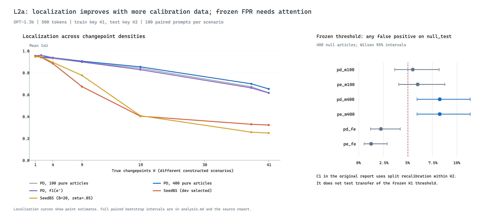

# L2a 实验结果分析（2026-11-07）

**本轮支持的主要结果是：增加纯水印校准数据后，HMM 的定位性能提高；HMM 在密集切换场景下明显优于本项目适配的 SeedBS。`f₁(e′)` 没有通过预先设定的收益判据，不能作为本轮得到支持的新方案。与此同时，跨密钥冻结阈值的误报、R2/R0 对照的有效编辑强度，以及大量重复上下文，限制了机制归因和误报控制的表述。**

分析对象为项目根目录下载的 `l2a-results.tar.gz` 中的 L2a 产物。源报告、配置、冻结参数及构建清单保存在本目录 `source/`；补充核对结果见 [audit.json](audit.json)。本分析未改动实验方法、配置、阈值或原始报告，未重跑拟合或选择测试集上的最优参数。L0/L1 的长度、密钥及构造与本轮不同，不对它们的分数作横向比较。

**正文抽查后的补充判断：生成质量问题比本报告最初的重复上下文提醒更严重。** 400 篇纯水印校准文章中，181 篇出现至少 100 token 的精确周期循环；同一批 100 个测试 prompt 下，水印续写为 56 篇，无水印续写为 0 篇。已有检测统计仍正确，但结论须限定于这批包含大量循环退化的生成文本。优先检查生成协议和基线文本质量，再决定下一轮检测实验。详见 [生成质量补充检查](generation_check.md) 和 [实际续写样本](text_samples.md)。

**1．数据和流程完整性**

- OPT-1.3b、arXiv 语料；prompt 为 50 token，生成长度 500，局部上下文宽度 4，有效位置数 496；不是 toy 运行。
- 训练侧 K1、测试侧 K2；训练侧 1,510 篇构造文章、748,960 个位置；测试侧 1,600 篇、793,600 个位置。测试的 1,200 篇含水印构造文章来自 200 个 prompt，另有 400 个独立 null prompt；不能把场景间共用来源的文章当成相互独立样本。
- 提示词共 2,110 个不同来源行，训练和测试来源行交集为 0。归档清单记录排除了 1,330 个旧来源组；旧轮完整提示词不在本次包内，本分析没有重新独立计算它们与本轮的全部交集。
- 11 个方法各有 1,600 条评估记录，共 17,600 条；方法和文章的组合没有重复。根据逐篇 TP/FP/FN 重算 IoU、按 prompt 汇总各块均值，均与报告一致。
- 生成配置与归档配置一致；冻结配置与训练构建配置一致。各阶段进度均到达总数，cap 扫描 30/30 完成。归档产物记录的代码提交与本地 HEAD 均为 `f47d138cd0db479ac02cd698af5aeb2af815d957`。
- 进度文件累计时间约 4.34 小时；fit 报告约 1.77 小时，test 报告约 1.93 小时。进度中的 BS 耗时接近 0 是计时归属问题：计算后才批量 tick，所以其计算耗时计入前面的阶段；不能据此认为 bootstrap 无成本。

**2．主要定位结果：m400 是本轮最稳的性能参照**

下表为原报告的平均 IoU，论文块只含 Setting 2–4。R2 为熵选择性编辑，R0 为不按熵选位置的编辑。

| 方法 | 论文块 | 等长交替块 | R2 | R0 |
|---|---:|---:|---:|---:|
| PD m100 | 0.940 | 0.757 | 0.704 | 0.520 |
| PE m100 | 0.936 | 0.751 | 0.701 | 0.513 |
| PD m400 | 0.945 | 0.777 | 0.744 | 0.557 |
| PE m400 | 0.944 | 0.772 | 0.741 | 0.552 |
| PD fe | 0.950 | 0.750 | 0.721 | 0.523 |
| PE fe | 0.949 | 0.751 | 0.721 | 0.523 |
| SeedBS（dev 选择版） | 0.926 | 0.431 | 0.627 | 0.321 |

增加纯水印样本后的差值在各块均为正。以下区间来自原定的 2,000 次按 prompt 配对 bootstrap。

| `m400 − m100` | PD：ΔIoU [95% CI] | PE：ΔIoU [95% CI] |
|---|---|---|
| 论文块 | +0.006 [0.001, 0.011] | +0.008 [0.002, 0.014] |
| 交替块 | +0.021 [0.017, 0.024] | +0.022 [0.018, 0.025] |
| R2 | +0.040 [0.017, 0.073] | +0.040 [0.018, 0.072] |
| R0 | +0.037 [0.031, 0.043] | +0.039 [0.033, 0.045] |

这支持“400 篇校准数据的完整拟合方案有收益”。两个方案各自经过 dev 选参，冻结 cap 分别为 10 和 25；不能进一步把提升全部归因于某一个密度箱的估计方差。全局比例估计的平均绝对误差仍约为 0.0616，几乎没随样本量改善，表明定位收益不等于比例估计精度提高。

PD 与 PE 的结果接近。m400 中，PD 在四块的点估计分别高约 0.0019、0.0047、0.0028、0.0052；差异规模都不到 0.01。本轮没有理由把初始分布形式作为主要提升来源。补充配对区间见 audit.json，属于事后描述性分析。

**3．`f₁(e′)` 的收益判据没有通过，机制也未得到确认**

| `fe − m400` | PD：ΔIoU [95% CI] | PE：ΔIoU [95% CI] |
|---|---|---|
| R2（预设适用域） | −0.023 [−0.059, 0.010] | −0.020 [−0.056, 0.012] |
| R0 | −0.034 [−0.044, −0.023] | −0.029 [−0.039, −0.019] |
| 论文块 | +0.005 [−0.002, 0.012] | +0.006 [−0.002, 0.013] |
| 交替块 | −0.027 [−0.035, −0.018] | −0.021 [−0.029, −0.013] |

R2 上两种初始分布都没有满足“差值区间下界大于 0”的 C2a。准确说法是“未获得收益证据”；其区间含 0，不能说已证明它在 R2 必然更差。R0 和交替块则呈现了明确的负差值。论文块的小幅正差值同样不构成优势证据。

两种 fe 都在 dev 上选中最小带宽 h=0.05、cap=10，dev 三类 IoU 约 0.821，高于 m400 的 0.808/0.804，但该优势没有迁移至 R2 测试块。所选核格点的最小有效位置数约 1,584，高于预设 300，不能简单把失败解释为没有满足最低样本数。选择噪声、估计占比噪声、训练数据异质性和分布失配均是后续待区分的可能性，当前结果不能确定是哪一种原因。

训练侧纯水印的 P(Y≥0.99)=0.3719。R2 编辑率 0.2 的差值为 −0.0380 [−0.0692, −0.0045]，0.5 为 −0.0757 [−0.1363, −0.0124]，但 0.3 反而为 +0.0160 [−0.0236, 0.0527]，低编辑率组也不单调。故预设的 M1 不成立。M2 按预定规则通过，但“区间含 0、点估计差小于 0.03”不等于正式证明分布等价；部分区间仍覆盖超过 0.03 的偏差。

因此不能照搬自动报告中“机制不存在”的字面表述。当前证据是：没有确认预先假设的、随名义编辑率单调增强的尾部削弱机制；并非已经证明熵选择性对存活分布没有影响。

**4．R2/R0 对照的有效编辑强度不匹配，这是机制归因的主要限制**

| 测试场景 | 名义编辑率 | 实际平均编辑率 | 有编辑不足的文章 | 存活水印占比 |
|---|---:|---:|---:|---:|
| R2 0.1 | 10% | 9.512% | 11/100 | 0.677 |
| R0 0.1 | 10% | 10.000% | 0/100 | 0.592 |
| R2 0.3 | 30% | 24.984% | 33/100 | 0.445 |
| R0 0.3 | 30% | 30.000% | 0/100 | 0.164 |

代码遇到高熵候选位置不足时，实际编辑数取候选数和请求数的较小值。训练侧名义 R2 0.5 也只有 37.055% 的实际平均编辑率，22/40 篇不足。除此之外，即使编辑数相同，编辑位置在局部聚集也会使“编辑位置及后续 4 个位置”的破坏窗口重叠，改变存活占比及游程分布。

所以计划中的“R2/R0 编辑数相同、破坏位置几乎相同、只差熵选择”没有被数据满足。R2 定位比 R0 容易，不足以证明它的枢轴分布更易识别。这不影响在同一测试文章上比较 fe 与 m400 的结果，但限制了跨 R2/R0 块的因果解释。

下一版机制实验应优先使用同一份原始 W 做配对，报告每篇实际编辑数、破坏位置数、存活占比和游程；若要单独归因于存活密度变化，还需匹配或分层这些难度因素。原始 W 的全体枢轴与同文存活子集应配对比较，不能仅与另一批纯水印文章的总体均值比较。当前训练机制各编辑率使用不同 prompt，每组 40 篇，文章间异质性会混入名义编辑率趋势。

**5．HMM 的主要优势在密集切换场景，但不宜只看 Rand index**

| 场景 | 真值 K | PD m400 IoU | dev SeedBS IoU | B=20、ζ=.05 SeedBS IoU |
|---|---:|---:|---:|---:|
| Setting 2 | 1 | 0.954 | 0.954 | 0.946 |
| Setting 3 | 2 | 0.945 | 0.941 | 0.945 |
| Setting 4 | 4 | 0.937 | 0.884 | 0.894 |
| alt50 | 9 | 0.905 | 0.673 | 0.775 |
| alt25 | 19 | 0.853 | 0.402 | 0.407 |
| alt_top，L=13 | 38 | 0.698 | 0.329 | 0.257 |
| alt12 | 41 | 0.652 | 0.322 | 0.248 |

dev 选择版 SeedBS 为 B=6、ζ=0.005；论文参数版 B=20 的最短候选区间为 50。在稀疏 Setting 2 上，某些较严格的论文 ζ 的 IoU、Rand 可以高于 HMM，因此不能声称 HMM 在全部场景胜过全部 SeedBS 参数。

密度增大时差距变得很大：PD m400 相对 dev SeedBS，在交替块的 ΔIoU=+0.346 [0.328, 0.362]。alt12 中，m400 检出切换点数约为真值的 85%，dev SeedBS 约 1%；后者有 80% 的文章把全部 496 个位置都标为水印，alt_top 中这一比例为 73%。它们约 0.32–0.33 的 IoU 不能解释为良好定位，其很大一部分来自整篇涂满后仍覆盖了正例。

HMM 的密集定位仍有损失：alt12 中 PD m400 的平均 precision=0.935、recall=0.685，说明主要问题偏向漏检。fe 把 recall 提高到 0.766，却把 precision 降到 0.771，最后 IoU 降到 0.614。这比单看“fe 检出更多片段”更能解释其代价。

报告的 Rand 是把每个连续片段视为不同簇的分段 Rand，不是逐位置水印二分类准确率。K 大时“大部分位置对属于不同簇”，该分数会天然偏高。作为解释性参照，alt12 若把每个位置都单独切成一段，即使完全不利用水印证据，Rand 也约为 0.978，而 PD m400 报告值为 0.944。这个参照没有参与实验选参，只说明跨密度读 Rand 时必须结合 IoU、边界和切换点数量。

论文块和交替块的结构参与了 A 的训练，当前结论限于这些已覆盖结构；密钥迁移是 K1 到 K2 这一次，不代表任意密钥、任意模型或未见编辑方式泛化。SeedBS 结论也限于项目适配实现，不能写成复现或全面否定原论文方法。

**6．C1 通过不等于冻结阈值在 K2 上维持 5% 误报**

| 方法 | 冻结 K1 阈值下 K2 any-FP | Wilson 95% CI | K2 内拆分重校准 p95 |
|---|---:|---|---:|
| PD m100 | 22/400 = 5.50% | [3.66%, 8.19%] | 8.025% |
| PE m100 | 24/400 = 6.00% | [4.06%, 8.77%] | 8.525% |
| PD m400 | 33/400 = 8.25% | [5.93%, 11.36%] | 8.025% |
| PE m400 | 33/400 = 8.25% | [5.93%, 11.36%] | 9.000% |
| PD fe | 9/400 = 2.25% | [1.19%, 4.22%] | 8.500% |
| PE fe | 5/400 = 1.25% | [0.54%, 2.89%] | 8.025% |

预设 C1 的确全部通过：在 400 篇 K2 null 内反复分成两半，一半重校准、另一半计算误报，中位数约 4.5%、p95 不超过 10%。该诊断考察 K2 内重校准后的行为；正式定位的标签仍来自 K1 冻结阈值，二者不是同一问题。

m400 的冻结阈值误报偏高，fe 偏保守。不能声称所有方法是在相同的实际 5% 误报水平下比较，也不能以 C1 通过为依据忽略这一差异。Wilson 区间是对给定已冻结阈值的条件性描述，没有包含重新抽取校准集时阈值本身的变化；一次运行不足以把偏差唯一归因于密钥。

本轮可保留原定分析；下一版宜重复独立校准集与测试密钥，单独考察冻结阈值迁移。不得用这次 K2 结果回头调阈值后再把它当作同一次未见测试。

**7．重复上下文很多，低熵存活位置并非简单的近均匀对照**

根据每篇 token 序列重数前 4 个 token 的上下文，训练纯水印文章平均有 40.81% 的位置重复了本篇先前上下文；null_cal 为 3.42%、null_test 为 3.17%。相同上下文在当前协议下会复用派生随机量，所以位置数量不能直接当作独立枢轴样本数。

特别是纯水印中熵小于 0.5 的 80,649 个位置，有 72,515 个（89.9%）属于重复上下文。在这些低熵位置中，首次上下文的 P(Y≥0.99)=0.0283，重复上下文的该比例为 0.3215，合并后为 0.2919。这一差异提示生成循环与固定上下文随机量复用可能影响经验枢轴分布，不能再把“低熵位置必然接近均匀”直接当作本数据已验证的性质。该分层分析是事后诊断，未改变检测流程，也未证明重复上下文是全部现象的唯一原因。

null 的总体枢轴仍大致接近均匀：null_cal 的均值 0.49987、P(Y≥0.99)=0.01027；null_test 对应 0.50139、0.00996。训练 f0 直方图 χ²=201.77，iid 参考的 95% 分位为 230.32；最大单箱相对偏差 0.124 略高于参考分位 0.115。不能据此认定零假设整体失效，也不能由总体近均匀推出位置独立。

**8．cap 扫描支持适度截断；本轮保留 dev 冻结值**

PD m100 在 cap=10 时，论文/交替/R2/R0 的平均 IoU 为 0.940/0.757/0.704/0.520；不截断时为 0.876/0.692/0.663/0.504。过小 cap=2 的对应值为 0.934/0.570/0.599/0.345。截断过强会丢失对短段的判别力，不截断也会损失性能。

按测试曲线描述，PD m100 的交替和 R2 块在 cap=10–15 附近形成较好的区域；论文块偏好更小 cap，R0 偏好更大 cap。不存在适合所有场景的单个测试最优值。本轮 dev 冻结 cap=10 是合理折中，不能用本次测试曲线换成 cap=12、15 或 25 再重报主结果。

**9．需要标注的实现与原计划差异**

计划说 h=∞ 时 fe 退化为 m400，实际 `Trainer.kernel` 仍把 400 篇纯水印和 mix_r2 的 truth=1 位置一起送入核估计；`KernelGrid.fit` 在 h=None 时对这整批位置等权。它退化成“纯水印与 R2 存活位置合并的固定直方图”，不是只用纯水印的 m400。本轮依据原始位置直方图计算，两者密度的积分绝对差约 0.03958，确实不相同。

本轮最终选中有限带宽 h=0.05，因此该差异不会把已报告的最终 fe 直接变成另一种 h；但它影响候选模型和嵌套基线的解释，应在下一版明确是修改实现还是修改方案说明，不能继续称其为严格包含 m400 的扩展。

此外，实际 alt12 的真值 K=41，因为 ceil(500/12)−1=41；计划表中的 40 是计算偏差。alt_top 由训练数据确定为 L=13、K=38，故它与 alt12 的密度很接近，没有覆盖预估的 K≈60。实际数据足以比较 K≤41，但不支持对更密集区间外推。E1 26 次与计划表 28 次的差异来自程序重算阶段单位，并不表示流程中断。

**10．后续工作顺序**

1. 保留本轮 m100 主方案和 m400 样本量对照，报告密集片段定位优势；将 fe 定位为本轮未得到支持的探索性变体。
2. 先做同源 W 的配对机制诊断，匹配或分层实际破坏率、存活占比和游程，并对重复上下文与首次上下文分别报告；重新设计的检验使用独立新数据。
3. 独立检查冻结阈值的跨校准集、跨密钥稳定性；报告两种误报口径，避免把重校准结果作为冻结阈值控制的证据。
4. 把 fe 的 h=∞ 行为与原计划对齐，再考虑是否值得开展新一版模型比较。当前数据不支持继续以更细 h 网格寻找测试收益。

主要证据：[测试报告](source/test.md)、[拟合报告](source/fit.md)、[机制报告](source/mechanism.md)、[cap 扫描](source/caps.md)、[补充核对](audit.json)。
