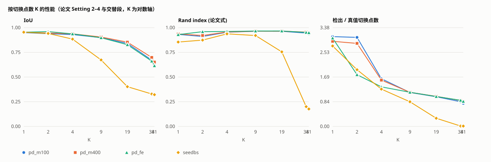

# L2 评价报告（一次 test，K2 密钥）

本报告的判据与解读规则在生成评价侧数据之前写定（plan_l2_paper_setting_20261106 §5）。沿用论文的数据构造与评价指标，检测量与算法按其适配，不是对论文方法的复现。

## 结论

C2a 不成立：f1(e') 在本数据上没有帮助，不改主线。 机制对照 M1 不成立：fe 仅作机制不存在时的对照，不当作新方案。

C1（误报，重校准 p95 ≤ 2α 且中位 ≤ α）：pd_m100=通过，pe_m100=通过，pd_m400=通过，pe_m400=通过，pd_fe=通过，pe_fe=通过
C2a：PD 不成立，PE 不成立。

## 主终点：IoU（按 prompt 配对 bootstrap，95% 区间）

| 方法 | 论文块（Setting 2–4） | 密度块（等长交替段） | R2 块（resample，熵选择性） | R0 块（resample，位置与熵无关） |
|---|---|---|---|---|
| pd_m100 | 0.940 [0.914, 0.961] | 0.757 [0.727, 0.782] | 0.704 [0.655, 0.751] | 0.520 [0.491, 0.547] |
| pe_m100 | 0.936 [0.910, 0.957] | 0.751 [0.721, 0.776] | 0.701 [0.652, 0.749] | 0.513 [0.484, 0.540] |
| pd_m400 | 0.945 [0.921, 0.966] | 0.777 [0.749, 0.801] | 0.744 [0.700, 0.784] | 0.557 [0.530, 0.582] |
| pe_m400 | 0.944 [0.919, 0.965] | 0.772 [0.744, 0.797] | 0.741 [0.697, 0.782] | 0.552 [0.524, 0.577] |
| pd_fe | 0.950 [0.924, 0.971] | 0.750 [0.725, 0.771] | 0.721 [0.674, 0.768] | 0.523 [0.500, 0.546] |
| pe_fe | 0.949 [0.922, 0.970] | 0.751 [0.726, 0.773] | 0.721 [0.673, 0.768] | 0.523 [0.499, 0.545] |
| seedbs | 0.926 [0.905, 0.944] | 0.431 [0.417, 0.445] | 0.627 [0.572, 0.680] | 0.321 [0.307, 0.334] |
| seedbs_paper_z0.05 | 0.928 [0.907, 0.945] | 0.422 [0.408, 0.434] | 0.631 [0.578, 0.683] | 0.315 [0.301, 0.328] |
| seedbs_paper_z0.01 | 0.921 [0.905, 0.934] | 0.403 [0.392, 0.413] | 0.629 [0.576, 0.680] | 0.330 [0.316, 0.342] |
| seedbs_paper_z0.005 | 0.849 [0.834, 0.863] | 0.392 [0.382, 0.400] | 0.629 [0.578, 0.679] | 0.338 [0.324, 0.349] |
| seedbs_paper_z0.001 | 0.783 [0.776, 0.788] | 0.389 [0.383, 0.393] | 0.628 [0.579, 0.676] | 0.348 [0.335, 0.359] |

## 主终点：论文式 Rand index（无缺口真值切换点）

| 方法 | 论文块（Setting 2–4） | 密度块（等长交替段） |
|---|---|---|
| pd_m100 | 0.932 [0.914, 0.947] | 0.952 [0.929, 0.968] |
| pe_m100 | 0.927 [0.909, 0.943] | 0.950 [0.927, 0.967] |
| pd_m400 | 0.938 [0.921, 0.952] | 0.957 [0.934, 0.972] |
| pe_m400 | 0.936 [0.919, 0.951] | 0.955 [0.932, 0.971] |
| pd_fe | 0.950 [0.934, 0.964] | 0.958 [0.935, 0.975] |
| pe_fe | 0.949 [0.932, 0.963] | 0.955 [0.931, 0.973] |
| seedbs | 0.889 [0.879, 0.898] | 0.513 [0.498, 0.529] |
| seedbs_paper_z0.05 | 0.878 [0.870, 0.887] | 0.711 [0.697, 0.726] |
| seedbs_paper_z0.01 | 0.914 [0.904, 0.924] | 0.449 [0.428, 0.469] |
| seedbs_paper_z0.005 | 0.875 [0.862, 0.889] | 0.336 [0.316, 0.356] |
| seedbs_paper_z0.001 | 0.632 [0.616, 0.648] | 0.062 [0.055, 0.069] |

## 随切换点数 K 的曲线（论文 Setting 2–4 与交替段）

**IoU**

| 档 | K | pd_m100 | pe_m100 | pd_m400 | pe_m400 | pd_fe | pe_fe | seedbs | seedbs_paper_z0.05 | seedbs_paper_z0.01 | seedbs_paper_z0.005 | seedbs_paper_z0.001 |
|---|---|---|---|---|---|---|---|---|---|---|---|---|
| set2 | 1.0 | 0.950 [0.927, 0.968] | 0.947 [0.923, 0.965] | 0.954 [0.931, 0.972] | 0.953 [0.929, 0.971] | 0.954 [0.930, 0.971] | 0.952 [0.928, 0.970] | 0.954 [0.929, 0.974] | 0.946 [0.924, 0.964] | 0.963 [0.948, 0.975] | 0.972 [0.958, 0.983] | 0.972 [0.955, 0.985] |
| set3 | 2.0 | 0.939 [0.911, 0.960] | 0.935 [0.907, 0.957] | 0.945 [0.918, 0.967] | 0.943 [0.916, 0.966] | 0.960 [0.932, 0.981] | 0.959 [0.930, 0.980] | 0.941 [0.923, 0.957] | 0.945 [0.926, 0.960] | 0.940 [0.922, 0.954] | 0.869 [0.847, 0.889] | 0.790 [0.790, 0.790] |
| set4 | 4.0 | 0.930 [0.904, 0.952] | 0.926 [0.900, 0.949] | 0.937 [0.911, 0.958] | 0.935 [0.908, 0.956] | 0.937 [0.909, 0.959] | 0.937 [0.908, 0.960] | 0.884 [0.854, 0.910] | 0.894 [0.870, 0.915] | 0.858 [0.832, 0.882] | 0.706 [0.679, 0.732] | 0.586 [0.578, 0.594] |
| alt50 | 9.0 | 0.899 [0.871, 0.921] | 0.895 [0.867, 0.918] | 0.905 [0.877, 0.927] | 0.903 [0.875, 0.925] | 0.898 [0.870, 0.918] | 0.898 [0.870, 0.920] | 0.673 [0.640, 0.702] | 0.775 [0.751, 0.798] | 0.573 [0.552, 0.591] | 0.502 [0.487, 0.515] | 0.464 [0.464, 0.464] |
| alt25 | 19.0 | 0.840 [0.810, 0.867] | 0.835 [0.804, 0.862] | 0.853 [0.822, 0.879] | 0.849 [0.818, 0.874] | 0.827 [0.801, 0.849] | 0.832 [0.804, 0.854] | 0.402 [0.387, 0.415] | 0.407 [0.394, 0.417] | 0.412 [0.398, 0.423] | 0.416 [0.405, 0.423] | 0.423 [0.423, 0.423] |
| alt_top | 38.0 | 0.671 [0.638, 0.702] | 0.663 [0.630, 0.695] | 0.698 [0.667, 0.728] | 0.693 [0.661, 0.723] | 0.661 [0.633, 0.685] | 0.661 [0.633, 0.686] | 0.329 [0.314, 0.340] | 0.257 [0.238, 0.274] | 0.321 [0.307, 0.332] | 0.333 [0.321, 0.343] | 0.343 [0.334, 0.349] |
| alt12 | 41.0 | 0.616 [0.583, 0.648] | 0.610 [0.576, 0.641] | 0.652 [0.618, 0.681] | 0.645 [0.612, 0.675] | 0.614 [0.586, 0.638] | 0.613 [0.583, 0.638] | 0.322 [0.309, 0.332] | 0.248 [0.232, 0.264] | 0.305 [0.292, 0.316] | 0.317 [0.304, 0.327] | 0.325 [0.311, 0.335] |

**Rand index**

| 档 | K | pd_m100 | pe_m100 | pd_m400 | pe_m400 | pd_fe | pe_fe | seedbs | seedbs_paper_z0.05 | seedbs_paper_z0.01 | seedbs_paper_z0.005 | seedbs_paper_z0.001 |
|---|---|---|---|---|---|---|---|---|---|---|---|---|
| set2 | 1.0 | 0.932 [0.912, 0.949] | 0.924 [0.905, 0.941] | 0.936 [0.918, 0.952] | 0.934 [0.916, 0.951] | 0.929 [0.911, 0.946] | 0.929 [0.911, 0.947] | 0.854 [0.839, 0.870] | 0.781 [0.765, 0.796] | 0.883 [0.866, 0.898] | 0.927 [0.912, 0.939] | 0.980 [0.972, 0.986] |
| set3 | 2.0 | 0.911 [0.891, 0.929] | 0.906 [0.886, 0.925] | 0.921 [0.900, 0.939] | 0.919 [0.898, 0.937] | 0.959 [0.940, 0.974] | 0.956 [0.937, 0.971] | 0.874 [0.861, 0.887] | 0.909 [0.898, 0.919] | 0.921 [0.904, 0.936] | 0.854 [0.825, 0.878] | 0.407 [0.385, 0.432] |
| set4 | 4.0 | 0.953 [0.936, 0.967] | 0.952 [0.934, 0.965] | 0.956 [0.938, 0.969] | 0.956 [0.938, 0.969] | 0.961 [0.942, 0.975] | 0.960 [0.941, 0.974] | 0.937 [0.927, 0.945] | 0.945 [0.941, 0.948] | 0.938 [0.930, 0.946] | 0.846 [0.827, 0.864] | 0.509 [0.468, 0.547] |
| alt50 | 9.0 | 0.963 [0.943, 0.976] | 0.963 [0.942, 0.976] | 0.964 [0.943, 0.977] | 0.963 [0.943, 0.976] | 0.966 [0.945, 0.979] | 0.962 [0.938, 0.979] | 0.920 [0.899, 0.935] | 0.960 [0.957, 0.964] | 0.900 [0.889, 0.909] | 0.776 [0.746, 0.803] | 0.137 [0.114, 0.162] |
| alt25 | 19.0 | 0.963 [0.940, 0.978] | 0.962 [0.939, 0.977] | 0.964 [0.941, 0.979] | 0.963 [0.940, 0.978] | 0.966 [0.943, 0.981] | 0.966 [0.942, 0.981] | 0.755 [0.723, 0.783] | 0.350 [0.301, 0.399] | 0.112 [0.081, 0.147] | 0.090 [0.066, 0.117] | 0.049 [0.048, 0.052] |
| alt_top | 38.0 | 0.945 [0.916, 0.967] | 0.943 [0.913, 0.966] | 0.955 [0.932, 0.973] | 0.951 [0.922, 0.972] | 0.952 [0.924, 0.974] | 0.950 [0.922, 0.972] | 0.201 [0.153, 0.248] | 0.748 [0.727, 0.768] | 0.344 [0.297, 0.391] | 0.188 [0.146, 0.237] | 0.031 [0.024, 0.043] |
| alt12 | 41.0 | 0.935 [0.906, 0.956] | 0.933 [0.904, 0.955] | 0.944 [0.915, 0.965] | 0.942 [0.914, 0.963] | 0.949 [0.922, 0.969] | 0.943 [0.910, 0.966] | 0.177 [0.137, 0.221] | 0.785 [0.772, 0.798] | 0.442 [0.397, 0.485] | 0.290 [0.240, 0.338] | 0.032 [0.022, 0.046] |

**检出切换点数 / 真值切换点数**

| 档 | K | pd_m100 | pe_m100 | pd_m400 | pe_m400 | pd_fe | pe_fe | seedbs | seedbs_paper_z0.05 | seedbs_paper_z0.01 | seedbs_paper_z0.005 | seedbs_paper_z0.001 |
|---|---|---|---|---|---|---|---|---|---|---|---|---|
| set2 | 1.0 | 3.07 | 3.21 | 2.91 | 3.04 | 3.02 | 3.04 | 2.75 | 4.17 | 2.16 | 1.62 | 1.02 |
| set3 | 2.0 | 3.04 | 3.16 | 2.84 | 3.00 | 1.77 | 1.81 | 1.94 | 2.10 | 1.34 | 0.94 | 0.08 |
| set4 | 4.0 | 1.63 | 1.66 | 1.58 | 1.64 | 1.35 | 1.39 | 1.27 | 1.55 | 1.11 | 0.80 | 0.29 |
| alt50 | 9.0 | 1.16 | 1.16 | 1.17 | 1.18 | 1.17 | 1.14 | 0.84 | 0.98 | 0.68 | 0.43 | 0.01 |
| alt25 | 19.0 | 1.01 | 1.01 | 1.03 | 1.03 | 1.02 | 1.02 | 0.28 | 0.06 | 0.01 | 0.01 | 0.00 |
| alt_top | 38.0 | 0.85 | 0.83 | 0.89 | 0.88 | 0.89 | 0.88 | 0.01 | 0.11 | 0.03 | 0.01 | 0.00 |
| alt12 | 41.0 | 0.79 | 0.78 | 0.85 | 0.84 | 0.86 | 0.83 | 0.01 | 0.12 | 0.04 | 0.02 | 0.00 |

## 判据

### C2a / C2b：fe − m400（ΔIoU）

| π | 块 | ΔIoU [95%] |
|---|---|---|
| pd | r2 | -0.023 [-0.059, 0.010] |
| pd | r0 | -0.034 [-0.044, -0.023] |
| pd | paper | 0.005 [-0.002, 0.012] |
| pd | alt | -0.027 [-0.035, -0.018] |
| pe | r2 | -0.020 [-0.056, 0.012] |
| pe | r0 | -0.029 [-0.039, -0.019] |
| pe | paper | 0.006 [-0.002, 0.013] |
| pe | alt | -0.021 [-0.029, -0.013] |

### C3：m400 − m100（ΔIoU）

| π | 块 | ΔIoU [95%] |
|---|---|---|
| pd | paper | 0.006 [0.001, 0.011] |
| pd | alt | 0.021 [0.017, 0.024] |
| pd | r2 | 0.040 [0.017, 0.073] |
| pd | r0 | 0.037 [0.031, 0.043] |
| pe | paper | 0.008 [0.002, 0.014] |
| pe | alt | 0.022 [0.018, 0.025] |
| pe | r2 | 0.040 [0.018, 0.072] |
| pe | r0 | 0.039 [0.033, 0.045] |

### C4：HMM 各臂 − seedbs（只报，不设判据）

参照 `seedbs`

| 方法 | 块 | ΔIoU | Δ论文式 Rand | Δ(S−B) Rand |
|---|---|---|---|---|
| pd_m100 | paper | 0.013 [0.002, 0.024] | 0.043 [0.026, 0.059] | 0.046 [0.028, 0.062] |
| pd_m100 | alt | 0.325 [0.306, 0.342] | 0.438 [0.410, 0.462] | 0.445 [0.416, 0.468] |
| pd_m100 | r2 | 0.077 [0.030, 0.118] | - | 0.227 [0.185, 0.271] |
| pd_m100 | r0 | 0.199 [0.177, 0.221] | - | 0.370 [0.324, 0.417] |
| pe_m100 | paper | 0.009 [-0.002, 0.020] | 0.039 [0.021, 0.055] | 0.042 [0.024, 0.058] |
| pe_m100 | alt | 0.319 [0.300, 0.336] | 0.437 [0.409, 0.460] | 0.444 [0.415, 0.467] |
| pe_m100 | r2 | 0.074 [0.027, 0.115] | - | 0.224 [0.182, 0.269] |
| pe_m100 | r0 | 0.192 [0.170, 0.214] | - | 0.367 [0.321, 0.415] |
| pd_m400 | paper | 0.019 [0.008, 0.030] | 0.049 [0.032, 0.064] | 0.052 [0.035, 0.067] |
| pd_m400 | alt | 0.346 [0.328, 0.362] | 0.444 [0.416, 0.466] | 0.451 [0.423, 0.473] |
| pd_m400 | r2 | 0.117 [0.065, 0.166] | - | 0.245 [0.203, 0.289] |
| pd_m400 | r0 | 0.236 [0.215, 0.256] | - | 0.402 [0.358, 0.446] |
| pe_m400 | paper | 0.017 [0.005, 0.029] | 0.048 [0.031, 0.063] | 0.051 [0.034, 0.066] |
| pe_m400 | alt | 0.341 [0.323, 0.357] | 0.442 [0.414, 0.465] | 0.449 [0.421, 0.472] |
| pe_m400 | r2 | 0.114 [0.062, 0.164] | - | 0.240 [0.198, 0.286] |
| pe_m400 | r0 | 0.231 [0.209, 0.251] | - | 0.399 [0.356, 0.443] |
| pd_fe | paper | 0.024 [0.012, 0.035] | 0.061 [0.043, 0.075] | 0.061 [0.043, 0.075] |
| pd_fe | alt | 0.319 [0.304, 0.333] | 0.445 [0.416, 0.469] | 0.448 [0.419, 0.471] |
| pd_fe | r2 | 0.094 [0.056, 0.128] | - | 0.237 [0.195, 0.283] |
| pd_fe | r0 | 0.203 [0.184, 0.220] | - | 0.405 [0.360, 0.447] |
| pe_fe | paper | 0.023 [0.010, 0.034] | 0.060 [0.042, 0.075] | 0.060 [0.042, 0.075] |
| pe_fe | alt | 0.320 [0.304, 0.334] | 0.442 [0.413, 0.466] | 0.445 [0.416, 0.469] |
| pe_fe | r2 | 0.094 [0.055, 0.127] | - | 0.236 [0.194, 0.282] |
| pe_fe | r0 | 0.202 [0.183, 0.220] | - | 0.401 [0.357, 0.443] |

参照 `seedbs_paper_z0.05`

| 方法 | 块 | ΔIoU | Δ论文式 Rand | Δ(S−B) Rand |
|---|---|---|---|---|
| pd_m100 | paper | 0.011 [0.000, 0.021] | 0.054 [0.038, 0.068] | 0.059 [0.043, 0.073] |
| pd_m100 | alt | 0.335 [0.316, 0.352] | 0.241 [0.211, 0.264] | 0.249 [0.219, 0.273] |
| pd_m100 | r2 | 0.073 [0.028, 0.112] | - | 0.074 [0.052, 0.097] |
| pd_m100 | r0 | 0.205 [0.183, 0.226] | - | 0.056 [0.020, 0.089] |
| pe_m100 | paper | 0.007 [-0.004, 0.018] | 0.049 [0.034, 0.063] | 0.055 [0.039, 0.069] |
| pe_m100 | alt | 0.329 [0.310, 0.347] | 0.239 [0.210, 0.263] | 0.247 [0.218, 0.271] |
| pe_m100 | r2 | 0.070 [0.024, 0.109] | - | 0.072 [0.049, 0.095] |
| pe_m100 | r0 | 0.198 [0.176, 0.219] | - | 0.053 [0.017, 0.086] |
| pd_m400 | paper | 0.017 [0.005, 0.028] | 0.060 [0.045, 0.073] | 0.065 [0.051, 0.078] |
| pd_m400 | alt | 0.355 [0.337, 0.372] | 0.246 [0.216, 0.270] | 0.254 [0.225, 0.278] |
| pd_m400 | r2 | 0.113 [0.063, 0.161] | - | 0.093 [0.068, 0.117] |
| pd_m400 | r0 | 0.242 [0.222, 0.261] | - | 0.088 [0.055, 0.118] |
| pe_m400 | paper | 0.015 [0.003, 0.026] | 0.058 [0.044, 0.071] | 0.064 [0.049, 0.077] |
| pe_m400 | alt | 0.351 [0.332, 0.367] | 0.244 [0.215, 0.267] | 0.253 [0.223, 0.276] |
| pe_m400 | r2 | 0.110 [0.060, 0.159] | - | 0.088 [0.063, 0.112] |
| pe_m400 | r0 | 0.237 [0.216, 0.257] | - | 0.085 [0.052, 0.115] |
| pd_fe | paper | 0.022 [0.012, 0.031] | 0.072 [0.056, 0.085] | 0.074 [0.058, 0.087] |
| pd_fe | alt | 0.328 [0.313, 0.343] | 0.247 [0.218, 0.271] | 0.252 [0.222, 0.276] |
| pd_fe | r2 | 0.090 [0.053, 0.122] | - | 0.085 [0.060, 0.109] |
| pd_fe | r0 | 0.209 [0.191, 0.226] | - | 0.091 [0.059, 0.117] |
| pe_fe | paper | 0.021 [0.010, 0.030] | 0.070 [0.055, 0.084] | 0.073 [0.057, 0.087] |
| pe_fe | alt | 0.329 [0.314, 0.344] | 0.244 [0.214, 0.269] | 0.249 [0.219, 0.274] |
| pe_fe | r2 | 0.090 [0.053, 0.122] | - | 0.083 [0.058, 0.107] |
| pe_fe | r0 | 0.208 [0.190, 0.225] | - | 0.087 [0.055, 0.114] |

参照 `seedbs_paper_z0.01`

| 方法 | 块 | ΔIoU | Δ论文式 Rand | Δ(S−B) Rand |
|---|---|---|---|---|
| pd_m100 | paper | 0.019 [0.002, 0.033] | 0.018 [0.005, 0.030] | 0.022 [0.010, 0.035] |
| pd_m100 | alt | 0.354 [0.332, 0.373] | 0.502 [0.471, 0.531] | 0.510 [0.479, 0.539] |
| pd_m100 | r2 | 0.075 [0.028, 0.115] | - | 0.207 [0.168, 0.247] |
| pd_m100 | r0 | 0.190 [0.168, 0.213] | - | 0.349 [0.300, 0.392] |
| pe_m100 | paper | 0.015 [-0.002, 0.030] | 0.013 [0.000, 0.026] | 0.018 [0.005, 0.030] |
| pe_m100 | alt | 0.348 [0.327, 0.367] | 0.501 [0.470, 0.530] | 0.509 [0.478, 0.538] |
| pe_m100 | r2 | 0.072 [0.025, 0.112] | - | 0.204 [0.164, 0.245] |
| pe_m100 | r0 | 0.183 [0.160, 0.205] | - | 0.346 [0.298, 0.389] |
| pd_m400 | paper | 0.025 [0.008, 0.039] | 0.024 [0.012, 0.035] | 0.028 [0.016, 0.040] |
| pd_m400 | alt | 0.374 [0.354, 0.392] | 0.507 [0.476, 0.535] | 0.516 [0.485, 0.544] |
| pd_m400 | r2 | 0.115 [0.064, 0.165] | - | 0.225 [0.186, 0.266] |
| pd_m400 | r0 | 0.227 [0.206, 0.248] | - | 0.380 [0.336, 0.422] |
| pe_m400 | paper | 0.023 [0.006, 0.038] | 0.022 [0.010, 0.034] | 0.027 [0.015, 0.039] |
| pe_m400 | alt | 0.370 [0.349, 0.387] | 0.506 [0.475, 0.534] | 0.514 [0.484, 0.543] |
| pe_m400 | r2 | 0.112 [0.061, 0.162] | - | 0.220 [0.180, 0.261] |
| pe_m400 | r0 | 0.222 [0.201, 0.243] | - | 0.378 [0.333, 0.419] |
| pd_fe | paper | 0.030 [0.012, 0.043] | 0.036 [0.024, 0.047] | 0.037 [0.025, 0.048] |
| pd_fe | alt | 0.347 [0.330, 0.362] | 0.509 [0.478, 0.538] | 0.513 [0.482, 0.542] |
| pd_fe | r2 | 0.092 [0.054, 0.124] | - | 0.217 [0.178, 0.258] |
| pd_fe | r0 | 0.194 [0.174, 0.212] | - | 0.383 [0.339, 0.423] |
| pe_fe | paper | 0.029 [0.010, 0.042] | 0.034 [0.022, 0.046] | 0.036 [0.024, 0.048] |
| pe_fe | alt | 0.348 [0.330, 0.364] | 0.506 [0.473, 0.535] | 0.511 [0.478, 0.540] |
| pe_fe | r2 | 0.092 [0.053, 0.125] | - | 0.216 [0.177, 0.257] |
| pe_fe | r0 | 0.193 [0.173, 0.211] | - | 0.380 [0.335, 0.420] |

参照 `seedbs_paper_z0.005`

| 方法 | 块 | ΔIoU | Δ论文式 Rand | Δ(S−B) Rand |
|---|---|---|---|---|
| pd_m100 | paper | 0.091 [0.069, 0.109] | 0.056 [0.040, 0.073] | 0.061 [0.045, 0.078] |
| pd_m100 | alt | 0.365 [0.342, 0.385] | 0.615 [0.584, 0.642] | 0.624 [0.592, 0.650] |
| pd_m100 | r2 | 0.075 [0.030, 0.114] | - | 0.295 [0.244, 0.349] |
| pd_m100 | r0 | 0.182 [0.158, 0.205] | - | 0.530 [0.485, 0.574] |
| pe_m100 | paper | 0.087 [0.065, 0.106] | 0.052 [0.035, 0.069] | 0.057 [0.040, 0.074] |
| pe_m100 | alt | 0.359 [0.336, 0.379] | 0.614 [0.583, 0.641] | 0.622 [0.591, 0.649] |
| pe_m100 | r2 | 0.072 [0.027, 0.111] | - | 0.292 [0.241, 0.346] |
| pe_m100 | r0 | 0.175 [0.152, 0.198] | - | 0.527 [0.482, 0.570] |
| pd_m400 | paper | 0.097 [0.075, 0.115] | 0.062 [0.046, 0.079] | 0.067 [0.051, 0.084] |
| pd_m400 | alt | 0.385 [0.364, 0.404] | 0.621 [0.590, 0.647] | 0.629 [0.598, 0.656] |
| pd_m400 | r2 | 0.115 [0.065, 0.164] | - | 0.313 [0.261, 0.368] |
| pd_m400 | r0 | 0.219 [0.196, 0.241] | - | 0.562 [0.519, 0.605] |
| pe_m400 | paper | 0.095 [0.073, 0.114] | 0.061 [0.045, 0.077] | 0.066 [0.050, 0.082] |
| pe_m400 | alt | 0.380 [0.359, 0.399] | 0.619 [0.588, 0.645] | 0.628 [0.596, 0.654] |
| pe_m400 | r2 | 0.112 [0.062, 0.161] | - | 0.308 [0.255, 0.363] |
| pe_m400 | r0 | 0.214 [0.191, 0.236] | - | 0.559 [0.517, 0.603] |
| pd_fe | paper | 0.101 [0.079, 0.120] | 0.075 [0.059, 0.090] | 0.076 [0.060, 0.092] |
| pd_fe | alt | 0.358 [0.340, 0.374] | 0.622 [0.590, 0.649] | 0.626 [0.594, 0.654] |
| pd_fe | r2 | 0.092 [0.055, 0.124] | - | 0.305 [0.253, 0.360] |
| pd_fe | r0 | 0.186 [0.165, 0.204] | - | 0.565 [0.523, 0.606] |
| pe_fe | paper | 0.100 [0.078, 0.119] | 0.073 [0.057, 0.088] | 0.075 [0.059, 0.091] |
| pe_fe | alt | 0.359 [0.340, 0.375] | 0.619 [0.586, 0.647] | 0.624 [0.591, 0.652] |
| pe_fe | r2 | 0.092 [0.054, 0.124] | - | 0.304 [0.252, 0.358] |
| pe_fe | r0 | 0.185 [0.164, 0.204] | - | 0.562 [0.520, 0.602] |

参照 `seedbs_paper_z0.001`

| 方法 | 块 | ΔIoU | Δ论文式 Rand | Δ(S−B) Rand |
|---|---|---|---|---|
| pd_m100 | paper | 0.157 [0.132, 0.178] | 0.300 [0.276, 0.321] | 0.306 [0.282, 0.328] |
| pd_m100 | alt | 0.368 [0.342, 0.390] | 0.889 [0.866, 0.907] | 0.897 [0.874, 0.915] |
| pd_m100 | r2 | 0.076 [0.027, 0.119] | - | 0.438 [0.368, 0.508] |
| pd_m100 | r0 | 0.172 [0.148, 0.196] | - | 0.801 [0.763, 0.834] |
| pe_m100 | paper | 0.153 [0.128, 0.175] | 0.295 [0.272, 0.317] | 0.302 [0.278, 0.324] |
| pe_m100 | alt | 0.362 [0.336, 0.384] | 0.888 [0.865, 0.906] | 0.896 [0.873, 0.914] |
| pe_m100 | r2 | 0.073 [0.024, 0.116] | - | 0.435 [0.366, 0.506] |
| pe_m100 | r0 | 0.165 [0.141, 0.189] | - | 0.798 [0.760, 0.831] |
| pd_m400 | paper | 0.163 [0.139, 0.184] | 0.306 [0.283, 0.326] | 0.312 [0.289, 0.333] |
| pd_m400 | alt | 0.388 [0.363, 0.410] | 0.894 [0.872, 0.912] | 0.903 [0.880, 0.920] |
| pd_m400 | r2 | 0.116 [0.068, 0.160] | - | 0.456 [0.385, 0.528] |
| pd_m400 | r0 | 0.209 [0.185, 0.231] | - | 0.833 [0.797, 0.864] |
| pe_m400 | paper | 0.161 [0.136, 0.182] | 0.304 [0.282, 0.325] | 0.311 [0.288, 0.331] |
| pe_m400 | alt | 0.384 [0.358, 0.405] | 0.893 [0.870, 0.910] | 0.901 [0.878, 0.919] |
| pe_m400 | r2 | 0.113 [0.065, 0.157] | - | 0.451 [0.382, 0.523] |
| pe_m400 | r0 | 0.204 [0.180, 0.227] | - | 0.830 [0.794, 0.861] |
| pd_fe | paper | 0.167 [0.142, 0.187] | 0.318 [0.295, 0.339] | 0.321 [0.298, 0.342] |
| pd_fe | alt | 0.361 [0.341, 0.380] | 0.896 [0.873, 0.914] | 0.900 [0.877, 0.918] |
| pd_fe | r2 | 0.093 [0.048, 0.129] | - | 0.448 [0.378, 0.519] |
| pd_fe | r0 | 0.175 [0.155, 0.194] | - | 0.836 [0.803, 0.863] |
| pe_fe | paper | 0.166 [0.141, 0.187] | 0.316 [0.293, 0.337] | 0.320 [0.296, 0.341] |
| pe_fe | alt | 0.362 [0.341, 0.381] | 0.893 [0.868, 0.912] | 0.897 [0.873, 0.917] |
| pe_fe | r2 | 0.093 [0.048, 0.129] | - | 0.447 [0.376, 0.518] |
| pe_fe | r0 | 0.175 [0.154, 0.194] | - | 0.833 [0.800, 0.860] |

## 误报（null_test）

| 方法 | 冻结 τ 下 any-FP | 重校准 p95 | 重校准中位 | C1 |
|---|---|---|---|---|
| pd_m100 | 0.055 (0.037–0.082) | 0.080 | 0.045 | 通过 |
| pe_m100 | 0.060 (0.041–0.088) | 0.085 | 0.045 | 通过 |
| pd_m400 | 0.083 (0.059–0.114) | 0.080 | 0.045 | 通过 |
| pe_m400 | 0.083 (0.059–0.114) | 0.090 | 0.045 | 通过 |
| pd_fe | 0.022 (0.012–0.042) | 0.085 | 0.045 | 通过 |
| pe_fe | 0.013 (0.005–0.029) | 0.080 | 0.045 | 通过 |
| seedbs | 0.040 (0.025–0.064) | 0.090 | 0.045 | 通过 |
| seedbs_paper_z0.05 | 0.040 (0.025–0.064) | 0.085 | 0.045 | 通过 |
| seedbs_paper_z0.01 | 0.040 (0.025–0.064) | 0.085 | 0.045 | 通过 |
| seedbs_paper_z0.005 | 0.043 (0.027–0.067) | 0.085 | 0.045 | 通过 |
| seedbs_paper_z0.001 | 0.037 (0.023–0.061) | 0.085 | 0.045 | 通过 |

## 次终点

| 方法 | Setting 1 recall | Setting 1 假切换点 | Setting 1 Rand | ε̂ 误差 | 后验饱和 | τ(均值) |
|---|---|---|---|---|---|---|
| pd_m100 | 0.944 | 5.41 | 0.674 [0.608, 0.740] | 0.062 | 0.259 | 0.5745 |
| pe_m100 | 0.940 | 5.76 | 0.651 [0.585, 0.718] | 0.062 | 0.259 | 0.6075 |
| pd_m400 | 0.950 | 4.86 | 0.717 [0.653, 0.780] | 0.062 | 0.296 | 0.6711 |
| pe_m400 | 0.948 | 5.37 | 0.711 [0.646, 0.775] | 0.062 | 0.296 | 0.6961 |
| pd_fe | 0.970 | 2.18 | 0.838 [0.781, 0.889] | 0.061 | 0.274 | 0.2561 |
| pe_fe | 0.967 | 2.26 | 0.836 [0.778, 0.887] | 0.061 | 0.274 | 0.3027 |
| seedbs | 0.987 | 2.66 | 0.495 [0.445, 0.548] | NA | NA | 0.9992 |
| seedbs_paper_z0.05 | 0.972 | 2.35 | 0.603 [0.551, 0.657] | NA | NA | 0.9993 |
| seedbs_paper_z0.01 | 0.987 | 1.14 | 0.726 [0.678, 0.773] | NA | NA | 0.9986 |
| seedbs_paper_z0.005 | 0.998 | 0.66 | 0.820 [0.776, 0.863] | NA | NA | 0.9959 |
| seedbs_paper_z0.001 | 1.000 | 0.08 | 0.974 [0.952, 0.991] | NA | NA | 0.9765 |

## A 的估计

| 方法 | cap | h | a00 | a00 bootstrap | a11 | a11 bootstrap | a00=a11 检验 p |
|---|---|---|---|---|---|---|---|
| pd_m100 | 10 | ∞ | 0.9652 | 0.9651 [0.9603, 0.9698] | 0.9670 | 0.9669 [0.9614, 0.9715] | 0.0208 |
| pe_m100 | 10 | ∞ | 0.9653 | 0.9651 [0.9604, 0.9699] | 0.9670 | 0.9670 [0.9615, 0.9716] | 0.0223 |
| pd_m400 | 25 | ∞ | 0.9640 | 0.9639 [0.9591, 0.9686] | 0.9678 | 0.9678 [0.9626, 0.9722] | 0.0000 |
| pe_m400 | 25 | ∞ | 0.9641 | 0.9639 [0.9592, 0.9687] | 0.9679 | 0.9678 [0.9626, 0.9722] | 0.0000 |
| pd_fe | 10 | 0.05 | 0.9697 | 0.9697 [0.9657, 0.9734] | 0.9738 | 0.9738 [0.9692, 0.9775] | 0.0000 |
| pe_fe | 10 | 0.05 | 0.9698 | 0.9697 [0.9657, 0.9735] | 0.9738 | 0.9738 [0.9692, 0.9776] | 0.0000 |

`A` 在 mix_r2、mix_splice、mix_alt 上拟合；`test_paper` 与 `test_alt` 对它是域内，不据此声称对未见结构泛化。

## R2 与 R0 的真值占比（应基本一致）

| 场景 | ε 真值均值 |
|---|---|
| r2_0.1 | 0.677 |
| r2_0.3 | 0.445 |
| r0_0.1 | 0.592 |
| r0_0.3 | 0.164 |

## 机制对照（训练侧，不读 test）

M1：不成立；M2：成立。

## 曲线

## 说明

- 非水印文本 U 来自同模型、同 prompt、不加水印的独立生成；论文没有写来源，这是本文的实现选择。
- 每块 100 个 prompt，配对 ΔIoU 区间半宽约 0.02，对 0.01 以下的差异没有分辨力，不作方向性断言。
- 等长交替段是规则的，resample 的存活游程长短不一，密度相当不等于难度相当。
- 训练侧密钥 K1、评价侧密钥 K2：f₁ 与 A 在 K1 下拟合，在 K2 下测试，同时检验密钥迁移。

## 进度单位实际用量（下一轮权重初值）

| 阶段 | 单位数 | 缓存 | 秒 |
|---|---|---|---|
| G1 | 1850 | 0 | 1114.3 |
| B1 | 1510 | 0 | 603.6 |
| D1 | 1 | 0 | 0.4 |
| F1 | 2 | 0 | 0.0 |
| E1 | 26 | 2 | 1632.3 |
| S1 | 84 | 0 | 16.2 |
| S2 | 20 | 0 | 11577.3 |
| T1 | 11 | 0 | 0.3 |
| G2 | 700 | 0 | 350.4 |
| B2 | 1600 | 0 | 190.8 |
| R1 | 17600 | 3200 | 33.4 |
| BS | 3000 | 0 | 0.0 |
| C1 | 30 | 0 | 90.3 |
| REP | 1 | 0 | 9.1 |

用时 81 秒。
