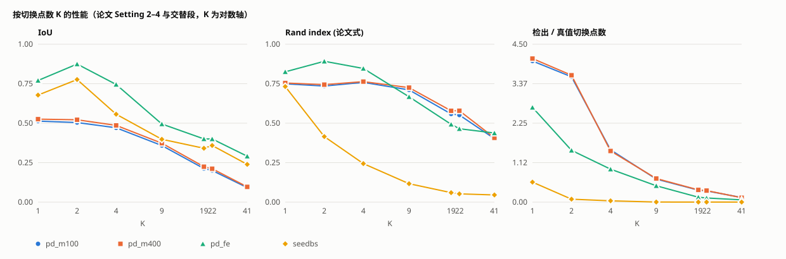

# L2 评价报告（一次 test，K2 密钥）

本报告的判据与解读规则在生成评价侧数据之前写定（plan_l2_paper_setting_20261106 §5）。沿用论文的数据构造与评价指标，检测量与算法按其适配，不是对论文方法的复现。

## 结论

来源未明：R0 上 fe − m400 > 0，收益不能归因于熵机制，不声称机制被证实。 机制对照 M1 不成立：fe 仅作机制不存在时的对照，不当作新方案。

C1（误报，重校准 p95 ≤ 2α 且中位 ≤ α）：pd_m100=通过，pe_m100=通过，pd_m400=通过，pe_m400=通过，pd_fe=通过，pe_fe=通过
C2a：PD 成立，PE 成立。

## 主终点：IoU（按 prompt 配对 bootstrap，95% 区间）

| 方法 | 论文块（Setting 2–4） | 密度块（等长交替段） | R2 块（resample，熵选择性） | R0 块（resample，位置与熵无关） |
|---|---|---|---|---|
| pd_m100 | 0.496 [0.448, 0.542] | 0.216 [0.185, 0.247] | 0.234 [0.185, 0.284] | 0.142 [0.120, 0.165] |
| pe_m100 | 0.448 [0.401, 0.497] | 0.195 [0.168, 0.224] | 0.195 [0.147, 0.247] | 0.127 [0.106, 0.148] |
| pd_m400 | 0.511 [0.463, 0.557] | 0.227 [0.196, 0.257] | 0.248 [0.198, 0.299] | 0.147 [0.125, 0.169] |
| pe_m400 | 0.467 [0.419, 0.515] | 0.207 [0.179, 0.235] | 0.209 [0.160, 0.259] | 0.133 [0.112, 0.155] |
| pd_fe | 0.797 [0.777, 0.815] | 0.397 [0.386, 0.406] | 0.713 [0.670, 0.753] | 0.315 [0.299, 0.330] |
| pe_fe | 0.810 [0.787, 0.830] | 0.393 [0.380, 0.403] | 0.693 [0.650, 0.733] | 0.306 [0.288, 0.322] |
| seedbs | 0.670 [0.646, 0.691] | 0.334 [0.311, 0.356] | 0.698 [0.654, 0.741] | 0.284 [0.266, 0.300] |
| seedbs_paper_z0.05 | 0.553 [0.508, 0.596] | 0.187 [0.166, 0.208] | 0.350 [0.301, 0.400] | 0.137 [0.119, 0.157] |
| seedbs_paper_z0.01 | 0.610 [0.570, 0.646] | 0.213 [0.189, 0.238] | 0.504 [0.449, 0.558] | 0.188 [0.164, 0.212] |
| seedbs_paper_z0.005 | 0.635 [0.605, 0.663] | 0.256 [0.231, 0.279] | 0.582 [0.528, 0.633] | 0.231 [0.210, 0.251] |
| seedbs_paper_z0.001 | 0.670 [0.646, 0.691] | 0.334 [0.311, 0.356] | 0.698 [0.654, 0.741] | 0.284 [0.266, 0.300] |

## 主终点：论文式 Rand index（无缺口真值切换点）

| 方法 | 论文块（Setting 2–4） | 密度块（等长交替段） |
|---|---|---|
| pd_m100 | 0.747 [0.723, 0.771] | 0.556 [0.510, 0.598] |
| pe_m100 | 0.725 [0.701, 0.749] | 0.514 [0.469, 0.556] |
| pd_m400 | 0.754 [0.730, 0.776] | 0.572 [0.529, 0.614] |
| pe_m400 | 0.734 [0.709, 0.758] | 0.532 [0.488, 0.575] |
| pd_fe | 0.854 [0.838, 0.870] | 0.516 [0.486, 0.545] |
| pe_fe | 0.876 [0.862, 0.888] | 0.582 [0.554, 0.608] |
| seedbs | 0.464 [0.444, 0.483] | 0.069 [0.062, 0.077] |
| seedbs_paper_z0.05 | 0.781 [0.773, 0.788] | 0.777 [0.764, 0.790] |
| seedbs_paper_z0.01 | 0.767 [0.749, 0.784] | 0.479 [0.458, 0.501] |
| seedbs_paper_z0.005 | 0.697 [0.677, 0.721] | 0.336 [0.312, 0.361] |
| seedbs_paper_z0.001 | 0.464 [0.444, 0.483] | 0.069 [0.062, 0.077] |

## 随切换点数 K 的曲线（论文 Setting 2–4 与交替段）

**IoU**

| 档 | K | pd_m100 | pe_m100 | pd_m400 | pe_m400 | pd_fe | pe_fe | seedbs | seedbs_paper_z0.05 | seedbs_paper_z0.01 | seedbs_paper_z0.005 | seedbs_paper_z0.001 |
|---|---|---|---|---|---|---|---|---|---|---|---|---|
| set2 | 1.0 | 0.513 [0.456, 0.570] | 0.476 [0.419, 0.533] | 0.526 [0.470, 0.583] | 0.491 [0.434, 0.548] | 0.771 [0.733, 0.804] | 0.795 [0.754, 0.831] | 0.678 [0.616, 0.739] | 0.581 [0.520, 0.639] | 0.672 [0.612, 0.730] | 0.701 [0.640, 0.757] | 0.678 [0.616, 0.739] |
| set3 | 2.0 | 0.504 [0.458, 0.550] | 0.447 [0.401, 0.494] | 0.522 [0.477, 0.567] | 0.470 [0.425, 0.516] | 0.874 [0.859, 0.890] | 0.867 [0.849, 0.884] | 0.776 [0.762, 0.787] | 0.552 [0.508, 0.597] | 0.647 [0.605, 0.689] | 0.693 [0.661, 0.723] | 0.776 [0.762, 0.787] |
| set4 | 4.0 | 0.471 [0.421, 0.520] | 0.423 [0.376, 0.471] | 0.486 [0.436, 0.536] | 0.441 [0.394, 0.490] | 0.745 [0.723, 0.765] | 0.768 [0.744, 0.791] | 0.557 [0.536, 0.574] | 0.525 [0.476, 0.572] | 0.511 [0.468, 0.554] | 0.511 [0.478, 0.543] | 0.557 [0.536, 0.574] |
| alt50 | 9.0 | 0.358 [0.315, 0.404] | 0.328 [0.287, 0.371] | 0.373 [0.330, 0.418] | 0.342 [0.302, 0.386] | 0.495 [0.475, 0.513] | 0.506 [0.483, 0.527] | 0.398 [0.365, 0.430] | 0.330 [0.292, 0.367] | 0.304 [0.268, 0.340] | 0.327 [0.292, 0.360] | 0.398 [0.365, 0.430] |
| alt25 | 19.0 | 0.213 [0.180, 0.249] | 0.189 [0.159, 0.221] | 0.224 [0.190, 0.260] | 0.202 [0.171, 0.235] | 0.401 [0.388, 0.410] | 0.394 [0.380, 0.406] | 0.341 [0.306, 0.371] | 0.180 [0.152, 0.208] | 0.220 [0.183, 0.255] | 0.265 [0.226, 0.300] | 0.341 [0.306, 0.371] |
| alt_top | 22.0 | 0.200 [0.168, 0.236] | 0.180 [0.152, 0.212] | 0.212 [0.180, 0.247] | 0.193 [0.164, 0.225] | 0.400 [0.389, 0.409] | 0.390 [0.379, 0.401] | 0.359 [0.328, 0.387] | 0.157 [0.130, 0.184] | 0.215 [0.180, 0.249] | 0.277 [0.242, 0.311] | 0.359 [0.328, 0.387] |
| alt12 | 41.0 | 0.092 [0.075, 0.111] | 0.084 [0.069, 0.100] | 0.097 [0.079, 0.115] | 0.089 [0.075, 0.106] | 0.291 [0.272, 0.306] | 0.280 [0.260, 0.296] | 0.239 [0.207, 0.269] | 0.080 [0.063, 0.097] | 0.114 [0.089, 0.139] | 0.156 [0.125, 0.184] | 0.239 [0.207, 0.269] |

**Rand index**

| 档 | K | pd_m100 | pe_m100 | pd_m400 | pe_m400 | pd_fe | pe_fe | seedbs | seedbs_paper_z0.05 | seedbs_paper_z0.01 | seedbs_paper_z0.005 | seedbs_paper_z0.001 |
|---|---|---|---|---|---|---|---|---|---|---|---|---|
| set2 | 1.0 | 0.749 [0.721, 0.774] | 0.734 [0.706, 0.758] | 0.754 [0.727, 0.779] | 0.743 [0.717, 0.768] | 0.825 [0.802, 0.846] | 0.840 [0.816, 0.862] | 0.732 [0.689, 0.776] | 0.685 [0.672, 0.698] | 0.757 [0.732, 0.782] | 0.759 [0.728, 0.789] | 0.732 [0.689, 0.776] |
| set3 | 2.0 | 0.735 [0.713, 0.757] | 0.705 [0.681, 0.727] | 0.744 [0.723, 0.765] | 0.719 [0.696, 0.741] | 0.892 [0.872, 0.909] | 0.901 [0.890, 0.912] | 0.415 [0.389, 0.443] | 0.775 [0.762, 0.788] | 0.775 [0.748, 0.798] | 0.708 [0.674, 0.739] | 0.415 [0.389, 0.443] |
| set4 | 4.0 | 0.758 [0.724, 0.791] | 0.737 [0.700, 0.771] | 0.763 [0.728, 0.796] | 0.740 [0.704, 0.775] | 0.846 [0.821, 0.869] | 0.885 [0.868, 0.900] | 0.244 [0.221, 0.269] | 0.882 [0.874, 0.890] | 0.768 [0.734, 0.801] | 0.626 [0.582, 0.665] | 0.244 [0.221, 0.269] |
| alt50 | 9.0 | 0.711 [0.670, 0.750] | 0.681 [0.639, 0.724] | 0.725 [0.685, 0.765] | 0.684 [0.641, 0.727] | 0.667 [0.625, 0.708] | 0.730 [0.693, 0.766] | 0.117 [0.103, 0.136] | 0.887 [0.876, 0.898] | 0.707 [0.674, 0.740] | 0.535 [0.491, 0.580] | 0.117 [0.103, 0.136] |
| alt25 | 19.0 | 0.558 [0.504, 0.613] | 0.514 [0.458, 0.571] | 0.578 [0.523, 0.632] | 0.536 [0.479, 0.591] | 0.493 [0.443, 0.547] | 0.568 [0.519, 0.617] | 0.060 [0.048, 0.075] | 0.717 [0.680, 0.749] | 0.383 [0.333, 0.434] | 0.243 [0.197, 0.291] | 0.060 [0.048, 0.075] |
| alt_top | 22.0 | 0.552 [0.495, 0.607] | 0.521 [0.467, 0.578] | 0.579 [0.524, 0.632] | 0.544 [0.489, 0.598] | 0.465 [0.409, 0.521] | 0.549 [0.495, 0.603] | 0.052 [0.042, 0.066] | 0.713 [0.679, 0.745] | 0.379 [0.329, 0.427] | 0.248 [0.204, 0.292] | 0.052 [0.042, 0.066] |
| alt12 | 41.0 | 0.402 [0.346, 0.457] | 0.341 [0.287, 0.392] | 0.407 [0.353, 0.462] | 0.364 [0.307, 0.418] | 0.438 [0.383, 0.497] | 0.479 [0.428, 0.531] | 0.046 [0.029, 0.067] | 0.792 [0.777, 0.806] | 0.448 [0.398, 0.495] | 0.317 [0.268, 0.365] | 0.046 [0.029, 0.067] |

**检出切换点数 / 真值切换点数**

| 档 | K | pd_m100 | pe_m100 | pd_m400 | pe_m400 | pd_fe | pe_fe | seedbs | seedbs_paper_z0.05 | seedbs_paper_z0.01 | seedbs_paper_z0.005 | seedbs_paper_z0.001 |
|---|---|---|---|---|---|---|---|---|---|---|---|---|
| set2 | 1.0 | 4.02 | 4.36 | 4.09 | 4.01 | 2.70 | 2.44 | 0.57 | 5.49 | 2.44 | 1.53 | 0.57 |
| set3 | 2.0 | 3.57 | 4.09 | 3.62 | 3.84 | 1.48 | 1.50 | 0.09 | 2.85 | 1.32 | 0.86 | 0.09 |
| set4 | 4.0 | 1.49 | 1.60 | 1.46 | 1.50 | 0.94 | 1.04 | 0.04 | 1.48 | 0.75 | 0.46 | 0.04 |
| alt50 | 9.0 | 0.66 | 0.62 | 0.67 | 0.61 | 0.47 | 0.52 | 0.00 | 0.74 | 0.38 | 0.21 | 0.00 |
| alt25 | 19.0 | 0.34 | 0.31 | 0.35 | 0.32 | 0.14 | 0.17 | 0.00 | 0.20 | 0.06 | 0.03 | 0.00 |
| alt_top | 22.0 | 0.32 | 0.30 | 0.33 | 0.31 | 0.12 | 0.15 | 0.00 | 0.18 | 0.05 | 0.03 | 0.00 |
| alt12 | 41.0 | 0.13 | 0.11 | 0.13 | 0.12 | 0.06 | 0.06 | 0.00 | 0.13 | 0.04 | 0.02 | 0.00 |

## 判据

### C2a / C2b：fe − m400（ΔIoU）

| π | 块 | ΔIoU [95%] |
|---|---|---|
| pd | r2 | 0.464 [0.408, 0.522] |
| pd | r0 | 0.168 [0.151, 0.185] |
| pd | paper | 0.286 [0.248, 0.323] |
| pd | alt | 0.170 [0.144, 0.196] |
| pe | r2 | 0.484 [0.429, 0.540] |
| pe | r0 | 0.173 [0.152, 0.191] |
| pe | paper | 0.343 [0.303, 0.381] |
| pe | alt | 0.186 [0.162, 0.208] |

### C3：m400 − m100（ΔIoU）

| π | 块 | ΔIoU [95%] |
|---|---|---|
| pd | paper | 0.015 [0.010, 0.020] |
| pd | alt | 0.011 [0.008, 0.013] |
| pd | r2 | 0.015 [0.009, 0.023] |
| pd | r0 | 0.005 [0.002, 0.007] |
| pe | paper | 0.019 [0.015, 0.023] |
| pe | alt | 0.011 [0.009, 0.013] |
| pe | r2 | 0.014 [0.009, 0.020] |
| pe | r0 | 0.007 [0.004, 0.009] |

### C4：HMM 各臂 − seedbs（只报，不设判据）

参照 `seedbs`

| 方法 | 块 | ΔIoU | Δ论文式 Rand | Δ(S−B) Rand |
|---|---|---|---|---|
| pd_m100 | paper | -0.174 [-0.213, -0.135] | 0.284 [0.263, 0.303] | 0.289 [0.268, 0.309] |
| pd_m100 | alt | -0.118 [-0.148, -0.090] | 0.487 [0.441, 0.531] | 0.489 [0.442, 0.534] |
| pd_m100 | r2 | -0.464 [-0.525, -0.403] | - | 0.308 [0.248, 0.365] |
| pd_m100 | r0 | -0.141 [-0.164, -0.117] | - | 0.377 [0.338, 0.416] |
| pe_m100 | paper | -0.222 [-0.261, -0.181] | 0.262 [0.240, 0.282] | 0.267 [0.245, 0.288] |
| pe_m100 | alt | -0.139 [-0.168, -0.112] | 0.445 [0.401, 0.490] | 0.447 [0.403, 0.492] |
| pe_m100 | r2 | -0.502 [-0.562, -0.443] | - | 0.291 [0.236, 0.343] |
| pe_m100 | r0 | -0.157 [-0.179, -0.133] | - | 0.332 [0.292, 0.372] |
| pd_m400 | paper | -0.159 [-0.197, -0.120] | 0.290 [0.270, 0.309] | 0.295 [0.276, 0.315] |
| pd_m400 | alt | -0.108 [-0.138, -0.079] | 0.504 [0.459, 0.547] | 0.506 [0.461, 0.549] |
| pd_m400 | r2 | -0.449 [-0.512, -0.386] | - | 0.314 [0.255, 0.372] |
| pd_m400 | r0 | -0.137 [-0.159, -0.113] | - | 0.378 [0.339, 0.417] |
| pe_m400 | paper | -0.203 [-0.242, -0.162] | 0.271 [0.249, 0.291] | 0.276 [0.254, 0.297] |
| pe_m400 | alt | -0.128 [-0.156, -0.100] | 0.463 [0.419, 0.507] | 0.465 [0.421, 0.509] |
| pe_m400 | r2 | -0.489 [-0.549, -0.429] | - | 0.290 [0.232, 0.348] |
| pe_m400 | r0 | -0.150 [-0.172, -0.127] | - | 0.344 [0.304, 0.384] |
| pd_fe | paper | 0.126 [0.107, 0.146] | 0.391 [0.371, 0.410] | 0.389 [0.370, 0.408] |
| pd_fe | alt | 0.062 [0.044, 0.082] | 0.447 [0.415, 0.478] | 0.446 [0.414, 0.477] |
| pd_fe | r2 | 0.015 [-0.026, 0.054] | - | 0.160 [0.122, 0.199] |
| pd_fe | r0 | 0.031 [0.016, 0.049] | - | 0.294 [0.250, 0.337] |
| pe_fe | paper | 0.140 [0.121, 0.158] | 0.412 [0.395, 0.430] | 0.411 [0.394, 0.429] |
| pe_fe | alt | 0.058 [0.040, 0.077] | 0.513 [0.484, 0.541] | 0.512 [0.483, 0.540] |
| pe_fe | r2 | -0.005 [-0.046, 0.035] | - | 0.231 [0.191, 0.274] |
| pe_fe | r0 | 0.022 [0.003, 0.042] | - | 0.344 [0.297, 0.388] |

参照 `seedbs_paper_z0.05`

| 方法 | 块 | ΔIoU | Δ论文式 Rand | Δ(S−B) Rand |
|---|---|---|---|---|
| pd_m100 | paper | -0.056 [-0.084, -0.029] | -0.033 [-0.057, -0.011] | -0.030 [-0.054, -0.009] |
| pd_m100 | alt | 0.029 [0.010, 0.048] | -0.222 [-0.274, -0.172] | -0.219 [-0.272, -0.169] |
| pd_m100 | r2 | -0.117 [-0.160, -0.073] | - | -0.092 [-0.137, -0.048] |
| pd_m100 | r0 | 0.005 [-0.011, 0.022] | - | -0.363 [-0.401, -0.324] |
| pe_m100 | paper | -0.104 [-0.132, -0.076] | -0.055 [-0.079, -0.033] | -0.053 [-0.076, -0.030] |
| pe_m100 | alt | 0.009 [-0.009, 0.026] | -0.263 [-0.315, -0.214] | -0.261 [-0.313, -0.211] |
| pe_m100 | r2 | -0.155 [-0.199, -0.111] | - | -0.110 [-0.160, -0.058] |
| pe_m100 | r0 | -0.010 [-0.027, 0.007] | - | -0.408 [-0.446, -0.368] |
| pd_m400 | paper | -0.041 [-0.069, -0.014] | -0.027 [-0.049, -0.006] | -0.024 [-0.046, -0.003] |
| pd_m400 | alt | 0.040 [0.021, 0.059] | -0.205 [-0.255, -0.157] | -0.202 [-0.253, -0.154] |
| pd_m400 | r2 | -0.102 [-0.146, -0.057] | - | -0.087 [-0.133, -0.040] |
| pd_m400 | r0 | 0.010 [-0.007, 0.027] | - | -0.362 [-0.400, -0.322] |
| pe_m400 | paper | -0.085 [-0.113, -0.058] | -0.046 [-0.070, -0.024] | -0.044 [-0.068, -0.020] |
| pe_m400 | alt | 0.020 [0.002, 0.038] | -0.246 [-0.298, -0.196] | -0.243 [-0.296, -0.193] |
| pe_m400 | r2 | -0.141 [-0.185, -0.098] | - | -0.110 [-0.158, -0.062] |
| pe_m400 | r0 | -0.004 [-0.020, 0.013] | - | -0.395 [-0.434, -0.357] |
| pd_fe | paper | 0.244 [0.208, 0.280] | 0.074 [0.059, 0.088] | 0.070 [0.055, 0.084] |
| pd_fe | alt | 0.210 [0.192, 0.226] | -0.262 [-0.290, -0.233] | -0.262 [-0.291, -0.234] |
| pd_fe | r2 | 0.362 [0.312, 0.415] | - | -0.240 [-0.301, -0.179] |
| pd_fe | r0 | 0.178 [0.160, 0.197] | - | -0.446 [-0.490, -0.400] |
| pe_fe | paper | 0.258 [0.224, 0.293] | 0.095 [0.084, 0.106] | 0.092 [0.081, 0.103] |
| pe_fe | alt | 0.206 [0.189, 0.221] | -0.196 [-0.223, -0.170] | -0.196 [-0.223, -0.170] |
| pe_fe | r2 | 0.342 [0.294, 0.393] | - | -0.169 [-0.227, -0.110] |
| pe_fe | r0 | 0.169 [0.147, 0.190] | - | -0.396 [-0.442, -0.350] |

参照 `seedbs_paper_z0.01`

| 方法 | 块 | ΔIoU | Δ论文式 Rand | Δ(S−B) Rand |
|---|---|---|---|---|
| pd_m100 | paper | -0.114 [-0.146, -0.083] | -0.019 [-0.040, 0.001] | -0.016 [-0.037, 0.005] |
| pd_m100 | alt | 0.003 [-0.018, 0.024] | 0.077 [0.022, 0.128] | 0.079 [0.023, 0.131] |
| pd_m100 | r2 | -0.270 [-0.322, -0.220] | - | 0.038 [-0.008, 0.081] |
| pd_m100 | r0 | -0.046 [-0.066, -0.025] | - | -0.081 [-0.132, -0.032] |
| pe_m100 | paper | -0.161 [-0.193, -0.130] | -0.041 [-0.062, -0.021] | -0.038 [-0.059, -0.018] |
| pe_m100 | alt | -0.018 [-0.038, 0.003] | 0.035 [-0.018, 0.087] | 0.037 [-0.016, 0.089] |
| pe_m100 | r2 | -0.308 [-0.360, -0.258] | - | 0.020 [-0.024, 0.062] |
| pe_m100 | r0 | -0.062 [-0.081, -0.041] | - | -0.126 [-0.178, -0.078] |
| pd_m400 | paper | -0.099 [-0.130, -0.068] | -0.013 [-0.033, 0.007] | -0.009 [-0.030, 0.010] |
| pd_m400 | alt | 0.013 [-0.007, 0.035] | 0.093 [0.041, 0.143] | 0.095 [0.043, 0.146] |
| pd_m400 | r2 | -0.255 [-0.309, -0.202] | - | 0.043 [-0.000, 0.085] |
| pd_m400 | r0 | -0.041 [-0.061, -0.021] | - | -0.081 [-0.131, -0.029] |
| pe_m400 | paper | -0.142 [-0.174, -0.111] | -0.032 [-0.054, -0.011] | -0.029 [-0.051, -0.008] |
| pe_m400 | alt | -0.007 [-0.026, 0.014] | 0.053 [-0.001, 0.103] | 0.055 [0.001, 0.105] |
| pe_m400 | r2 | -0.295 [-0.346, -0.244] | - | 0.020 [-0.027, 0.064] |
| pe_m400 | r0 | -0.055 [-0.074, -0.035] | - | -0.114 [-0.165, -0.067] |
| pd_fe | paper | 0.187 [0.157, 0.218] | 0.088 [0.071, 0.106] | 0.084 [0.067, 0.103] |
| pd_fe | alt | 0.183 [0.162, 0.203] | 0.037 [0.004, 0.069] | 0.036 [0.004, 0.069] |
| pd_fe | r2 | 0.209 [0.159, 0.259] | - | -0.110 [-0.156, -0.066] |
| pd_fe | r0 | 0.127 [0.106, 0.149] | - | -0.164 [-0.220, -0.108] |
| pe_fe | paper | 0.200 [0.171, 0.231] | 0.109 [0.093, 0.125] | 0.106 [0.090, 0.123] |
| pe_fe | alt | 0.179 [0.159, 0.198] | 0.102 [0.069, 0.135] | 0.102 [0.069, 0.134] |
| pe_fe | r2 | 0.189 [0.141, 0.238] | - | -0.039 [-0.085, 0.007] |
| pe_fe | r0 | 0.118 [0.094, 0.142] | - | -0.115 [-0.170, -0.060] |

参照 `seedbs_paper_z0.005`

| 方法 | 块 | ΔIoU | Δ论文式 Rand | Δ(S−B) Rand |
|---|---|---|---|---|
| pd_m100 | paper | -0.139 [-0.174, -0.104] | 0.050 [0.026, 0.072] | 0.054 [0.030, 0.076] |
| pd_m100 | alt | -0.040 [-0.064, -0.016] | 0.220 [0.170, 0.269] | 0.222 [0.172, 0.271] |
| pd_m100 | r2 | -0.348 [-0.401, -0.294] | - | 0.124 [0.073, 0.175] |
| pd_m100 | r0 | -0.088 [-0.109, -0.067] | - | 0.091 [0.035, 0.146] |
| pe_m100 | paper | -0.187 [-0.222, -0.151] | 0.028 [0.004, 0.050] | 0.031 [0.008, 0.054] |
| pe_m100 | alt | -0.061 [-0.083, -0.038] | 0.178 [0.129, 0.228] | 0.181 [0.130, 0.231] |
| pe_m100 | r2 | -0.387 [-0.439, -0.334] | - | 0.107 [0.061, 0.152] |
| pe_m100 | r0 | -0.104 [-0.124, -0.083] | - | 0.046 [-0.009, 0.102] |
| pd_m400 | paper | -0.124 [-0.158, -0.090] | 0.056 [0.034, 0.078] | 0.060 [0.037, 0.082] |
| pd_m400 | alt | -0.030 [-0.053, -0.006] | 0.237 [0.187, 0.284] | 0.239 [0.189, 0.286] |
| pd_m400 | r2 | -0.334 [-0.387, -0.278] | - | 0.130 [0.081, 0.181] |
| pd_m400 | r0 | -0.084 [-0.104, -0.063] | - | 0.091 [0.037, 0.145] |
| pe_m400 | paper | -0.168 [-0.203, -0.132] | 0.037 [0.013, 0.059] | 0.040 [0.016, 0.063] |
| pe_m400 | alt | -0.050 [-0.072, -0.027] | 0.196 [0.145, 0.244] | 0.198 [0.147, 0.246] |
| pe_m400 | r2 | -0.373 [-0.426, -0.320] | - | 0.107 [0.057, 0.158] |
| pe_m400 | r0 | -0.097 [-0.116, -0.077] | - | 0.058 [0.006, 0.114] |
| pd_fe | paper | 0.162 [0.137, 0.186] | 0.157 [0.134, 0.179] | 0.154 [0.131, 0.176] |
| pd_fe | alt | 0.140 [0.120, 0.161] | 0.180 [0.141, 0.218] | 0.179 [0.140, 0.217] |
| pd_fe | r2 | 0.131 [0.088, 0.176] | - | -0.023 [-0.067, 0.020] |
| pd_fe | r0 | 0.084 [0.068, 0.101] | - | 0.008 [-0.047, 0.064] |
| pe_fe | paper | 0.175 [0.152, 0.197] | 0.178 [0.157, 0.198] | 0.176 [0.155, 0.196] |
| pe_fe | alt | 0.136 [0.118, 0.156] | 0.246 [0.209, 0.282] | 0.245 [0.208, 0.281] |
| pe_fe | r2 | 0.111 [0.069, 0.155] | - | 0.048 [0.002, 0.091] |
| pe_fe | r0 | 0.075 [0.056, 0.094] | - | 0.058 [0.000, 0.112] |

参照 `seedbs_paper_z0.001`

| 方法 | 块 | ΔIoU | Δ论文式 Rand | Δ(S−B) Rand |
|---|---|---|---|---|
| pd_m100 | paper | -0.174 [-0.213, -0.135] | 0.284 [0.263, 0.303] | 0.289 [0.268, 0.309] |
| pd_m100 | alt | -0.118 [-0.148, -0.090] | 0.487 [0.441, 0.531] | 0.489 [0.442, 0.534] |
| pd_m100 | r2 | -0.464 [-0.525, -0.403] | - | 0.308 [0.248, 0.365] |
| pd_m100 | r0 | -0.141 [-0.164, -0.117] | - | 0.377 [0.338, 0.416] |
| pe_m100 | paper | -0.222 [-0.261, -0.181] | 0.262 [0.240, 0.282] | 0.267 [0.245, 0.288] |
| pe_m100 | alt | -0.139 [-0.168, -0.112] | 0.445 [0.401, 0.490] | 0.447 [0.403, 0.492] |
| pe_m100 | r2 | -0.502 [-0.562, -0.443] | - | 0.291 [0.236, 0.343] |
| pe_m100 | r0 | -0.157 [-0.179, -0.133] | - | 0.332 [0.292, 0.372] |
| pd_m400 | paper | -0.159 [-0.197, -0.120] | 0.290 [0.270, 0.309] | 0.295 [0.276, 0.315] |
| pd_m400 | alt | -0.108 [-0.138, -0.079] | 0.504 [0.459, 0.547] | 0.506 [0.461, 0.549] |
| pd_m400 | r2 | -0.449 [-0.512, -0.386] | - | 0.314 [0.255, 0.372] |
| pd_m400 | r0 | -0.137 [-0.159, -0.113] | - | 0.378 [0.339, 0.417] |
| pe_m400 | paper | -0.203 [-0.242, -0.162] | 0.271 [0.249, 0.291] | 0.276 [0.254, 0.297] |
| pe_m400 | alt | -0.128 [-0.156, -0.100] | 0.463 [0.419, 0.507] | 0.465 [0.421, 0.509] |
| pe_m400 | r2 | -0.489 [-0.549, -0.429] | - | 0.290 [0.232, 0.348] |
| pe_m400 | r0 | -0.150 [-0.172, -0.127] | - | 0.344 [0.304, 0.384] |
| pd_fe | paper | 0.126 [0.107, 0.146] | 0.391 [0.371, 0.410] | 0.389 [0.370, 0.408] |
| pd_fe | alt | 0.062 [0.044, 0.082] | 0.447 [0.415, 0.478] | 0.446 [0.414, 0.477] |
| pd_fe | r2 | 0.015 [-0.026, 0.054] | - | 0.160 [0.122, 0.199] |
| pd_fe | r0 | 0.031 [0.016, 0.049] | - | 0.294 [0.250, 0.337] |
| pe_fe | paper | 0.140 [0.121, 0.158] | 0.412 [0.395, 0.430] | 0.411 [0.394, 0.429] |
| pe_fe | alt | 0.058 [0.040, 0.077] | 0.513 [0.484, 0.541] | 0.512 [0.483, 0.540] |
| pe_fe | r2 | -0.005 [-0.046, 0.035] | - | 0.231 [0.191, 0.274] |
| pe_fe | r0 | 0.022 [0.003, 0.042] | - | 0.344 [0.297, 0.388] |

## 误报（null_test）

| 方法 | 冻结 τ 下 any-FP | 重校准 p95 | 重校准中位 | C1 |
|---|---|---|---|---|
| pd_m100 | 0.037 (0.023–0.061) | 0.085 | 0.045 | 通过 |
| pe_m100 | 0.028 (0.015–0.049) | 0.085 | 0.045 | 通过 |
| pd_m400 | 0.033 (0.019–0.055) | 0.085 | 0.045 | 通过 |
| pe_m400 | 0.030 (0.017–0.052) | 0.090 | 0.045 | 通过 |
| pd_fe | 0.043 (0.027–0.067) | 0.085 | 0.050 | 通过 |
| pe_fe | 0.033 (0.019–0.055) | 0.080 | 0.050 | 通过 |
| seedbs | 0.060 (0.041–0.088) | 0.090 | 0.050 | 通过 |
| seedbs_paper_z0.05 | 0.072 (0.051–0.102) | 0.090 | 0.045 | 通过 |
| seedbs_paper_z0.01 | 0.055 (0.037–0.082) | 0.085 | 0.050 | 通过 |
| seedbs_paper_z0.005 | 0.065 (0.045–0.094) | 0.085 | 0.050 | 通过 |
| seedbs_paper_z0.001 | 0.060 (0.041–0.088) | 0.090 | 0.050 | 通过 |

## 次终点

| 方法 | Setting 1 recall | Setting 1 假切换点 | Setting 1 Rand | ε̂ 误差 | 后验饱和 | τ(均值) |
|---|---|---|---|---|---|---|
| pd_m100 | 0.512 | 8.34 | 0.311 [0.268, 0.357] | 0.181 | 0.079 | 0.9055 |
| pe_m100 | 0.452 | 10.09 | 0.288 [0.249, 0.330] | 0.181 | 0.076 | 0.9334 |
| pd_m400 | 0.530 | 8.34 | 0.305 [0.264, 0.350] | 0.181 | 0.078 | 0.8869 |
| pe_m400 | 0.475 | 9.26 | 0.295 [0.256, 0.339] | 0.181 | 0.076 | 0.9189 |
| pd_fe | 0.914 | 1.95 | 0.658 [0.608, 0.710] | 0.181 | 0.136 | 0.2498 |
| pe_fe | 0.894 | 2.25 | 0.609 [0.558, 0.664] | 0.185 | 0.144 | 0.3506 |
| seedbs | 0.991 | 0.14 | 0.943 [0.913, 0.972] | NA | NA | 0.9737 |
| seedbs_paper_z0.05 | 0.602 | 5.51 | 0.231 [0.206, 0.261] | NA | NA | 0.9984 |
| seedbs_paper_z0.01 | 0.823 | 2.18 | 0.497 [0.458, 0.541] | NA | NA | 0.9979 |
| seedbs_paper_z0.005 | 0.896 | 1.26 | 0.638 [0.594, 0.684] | NA | NA | 0.9946 |
| seedbs_paper_z0.001 | 0.991 | 0.14 | 0.943 [0.913, 0.972] | NA | NA | 0.9737 |

## A 的估计

| 方法 | cap | h | a00 | a00 bootstrap | a11 | a11 bootstrap | a00=a11 检验 p |
|---|---|---|---|---|---|---|---|
| pd_m100 | 5 | ∞ | 0.9803 | 0.9802 [0.9763, 0.9838] | 0.9800 | 0.9799 [0.9756, 0.9837] | 0.6388 |
| pe_m100 | 5 | ∞ | 0.9797 | 0.9796 [0.9756, 0.9833] | 0.9789 | 0.9789 [0.9744, 0.9829] | 0.2696 |
| pd_m400 | 5 | ∞ | 0.9810 | 0.9809 [0.9773, 0.9842] | 0.9792 | 0.9792 [0.9752, 0.9832] | 0.0099 |
| pe_m400 | 5 | ∞ | 0.9805 | 0.9804 [0.9767, 0.9837] | 0.9782 | 0.9782 [0.9741, 0.9822] | 0.0011 |
| pd_fe | 5 | 0.05 | 0.9835 | 0.9834 [0.9799, 0.9865] | 0.9934 | 0.9933 [0.9921, 0.9946] | 0.0000 |
| pe_fe | 10 | 0.05 | 0.9840 | 0.9839 [0.9803, 0.9872] | 0.9933 | 0.9932 [0.9919, 0.9945] | 0.0000 |

`A` 在 mix_r2、mix_splice、mix_alt 上拟合；`test_paper` 与 `test_alt` 对它是域内，不据此声称对未见结构泛化。

## R2 与 R0 的真值占比（应基本一致）

| 场景 | ε 真值均值 |
|---|---|
| r2_0.1 | 0.781 |
| r2_0.3 | 0.730 |
| r0_0.1 | 0.592 |
| r0_0.3 | 0.164 |

## 机制对照（训练侧，不读 test）

M1：不成立；M2：成立。

## 曲线

## 说明

- 非水印文本 U 来自同模型、同 prompt、不加水印的独立生成；论文没有写来源，这是本文的实现选择。
- 每块 100 个 prompt，配对 ΔIoU 区间半宽约 0.02，对 0.01 以下的差异没有分辨力，不作方向性断言。
- 等长交替段是规则的，resample 的存活游程长短不一，密度相当不等于难度相当。
- 训练侧密钥 K1、评价侧密钥 K2：f₁ 与 A 在 K1 下拟合，在 K2 下测试，同时检验密钥迁移。

## 进度单位实际用量（下一轮权重初值）

| 阶段 | 单位数 | 缓存 | 秒 |
|---|---|---|---|
| G1 | 1850 | 0 | 34115.0 |
| B1 | 1510 | 0 | 1775.2 |
| D1 | 1 | 0 | 0.2 |
| F1 | 2 | 0 | 0.0 |
| E1 | 26 | 0 | 13464.0 |
| S1 | 84 | 0 | 9.6 |
| S2 | 20 | 0 | 15.9 |
| T1 | 11 | 0 | 0.5 |
| G2 | 700 | 0 | 39600.7 |
| B2 | 1600 | 0 | 10467.6 |
| R1 | 17600 | 1600 | 35.7 |
| BS | 3000 | 0 | 0.0 |
| C1 | 0 | 0 | 0.0 |
| REP | 1 | 0 | 4.8 |

用时 62 秒。
