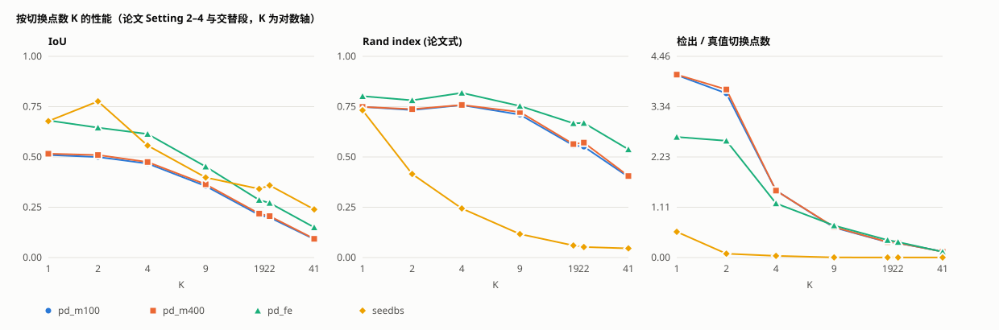

# L2 评价报告（一次 test，K2 密钥）

本报告的判据与解读规则在生成评价侧数据之前写定（plan_l2_paper_setting_20261106 §5）。沿用论文的数据构造与评价指标，检测量与算法按其适配，不是对论文方法的复现。

## 结论

来源未明：R0 上 fe − m400 > 0，收益不能归因于熵机制，不声称机制被证实。 机制对照 M1 不成立：fe 仅作机制不存在时的对照，不当作新方案。

C1（误报，重校准 p95 ≤ 2α 且中位 ≤ α）：pd_m100=通过，pe_m100=通过，pd_m400=通过，pe_m400=通过，pd_fe=通过，pe_fe=通过
C2a：PD 成立，PE 成立。

## 主终点：IoU（按 prompt 配对 bootstrap，95% 区间）

| 方法 | 论文块（Setting 2–4） | 密度块（等长交替段） | R2 块（resample，熵选择性） | R0 块（resample，位置与熵无关） |
|---|---|---|---|---|
| pd_m100 | 0.492 [0.445, 0.539] | 0.214 [0.184, 0.245] | 0.215 [0.169, 0.260] | 0.137 [0.115, 0.159] |
| pe_m100 | 0.444 [0.396, 0.492] | 0.193 [0.166, 0.222] | 0.177 [0.133, 0.223] | 0.121 [0.101, 0.141] |
| pd_m400 | 0.500 [0.452, 0.546] | 0.220 [0.190, 0.251] | 0.224 [0.177, 0.269] | 0.141 [0.119, 0.162] |
| pe_m400 | 0.463 [0.415, 0.510] | 0.206 [0.178, 0.234] | 0.191 [0.147, 0.237] | 0.130 [0.109, 0.150] |
| pd_fe | 0.647 [0.610, 0.680] | 0.290 [0.259, 0.318] | 0.415 [0.366, 0.457] | 0.198 [0.177, 0.220] |
| pe_fe | 0.566 [0.525, 0.604] | 0.253 [0.223, 0.281] | 0.317 [0.269, 0.362] | 0.166 [0.146, 0.186] |
| seedbs | 0.670 [0.646, 0.691] | 0.334 [0.311, 0.356] | 0.692 [0.646, 0.738] | 0.282 [0.263, 0.298] |
| seedbs_paper_z0.05 | 0.553 [0.508, 0.596] | 0.187 [0.166, 0.208] | 0.338 [0.290, 0.383] | 0.136 [0.117, 0.154] |
| seedbs_paper_z0.01 | 0.610 [0.570, 0.646] | 0.213 [0.189, 0.238] | 0.495 [0.442, 0.548] | 0.185 [0.162, 0.210] |
| seedbs_paper_z0.005 | 0.635 [0.605, 0.663] | 0.256 [0.231, 0.279] | 0.574 [0.520, 0.625] | 0.228 [0.208, 0.247] |
| seedbs_paper_z0.001 | 0.670 [0.646, 0.691] | 0.334 [0.311, 0.356] | 0.692 [0.646, 0.738] | 0.282 [0.263, 0.298] |

## 主终点：论文式 Rand index（无缺口真值切换点）

| 方法 | 论文块（Setting 2–4） | 密度块（等长交替段） |
|---|---|---|
| pd_m100 | 0.747 [0.722, 0.770] | 0.555 [0.510, 0.598] |
| pe_m100 | 0.724 [0.700, 0.748] | 0.512 [0.467, 0.554] |
| pd_m400 | 0.748 [0.723, 0.771] | 0.566 [0.522, 0.608] |
| pe_m400 | 0.732 [0.707, 0.756] | 0.533 [0.489, 0.576] |
| pd_fe | 0.801 [0.780, 0.820] | 0.657 [0.615, 0.695] |
| pe_fe | 0.759 [0.735, 0.781] | 0.591 [0.544, 0.635] |
| seedbs | 0.464 [0.444, 0.483] | 0.069 [0.062, 0.077] |
| seedbs_paper_z0.05 | 0.781 [0.773, 0.788] | 0.777 [0.764, 0.790] |
| seedbs_paper_z0.01 | 0.767 [0.749, 0.784] | 0.479 [0.458, 0.501] |
| seedbs_paper_z0.005 | 0.697 [0.677, 0.721] | 0.336 [0.312, 0.361] |
| seedbs_paper_z0.001 | 0.464 [0.444, 0.483] | 0.069 [0.062, 0.077] |

## 随切换点数 K 的曲线（论文 Setting 2–4 与交替段）

**IoU**

| 档 | K | pd_m100 | pe_m100 | pd_m400 | pe_m400 | pd_fe | pe_fe | seedbs | seedbs_paper_z0.05 | seedbs_paper_z0.01 | seedbs_paper_z0.005 | seedbs_paper_z0.001 |
|---|---|---|---|---|---|---|---|---|---|---|---|---|
| set2 | 1.0 | 0.510 [0.452, 0.567] | 0.472 [0.415, 0.528] | 0.516 [0.460, 0.572] | 0.487 [0.430, 0.544] | 0.681 [0.626, 0.732] | 0.611 [0.554, 0.666] | 0.678 [0.616, 0.739] | 0.581 [0.520, 0.639] | 0.672 [0.612, 0.730] | 0.701 [0.640, 0.757] | 0.678 [0.616, 0.739] |
| set3 | 2.0 | 0.500 [0.454, 0.546] | 0.442 [0.396, 0.489] | 0.509 [0.465, 0.556] | 0.464 [0.419, 0.511] | 0.646 [0.615, 0.677] | 0.557 [0.522, 0.592] | 0.776 [0.762, 0.787] | 0.552 [0.508, 0.597] | 0.647 [0.605, 0.689] | 0.693 [0.661, 0.723] | 0.776 [0.762, 0.787] |
| set4 | 4.0 | 0.467 [0.418, 0.516] | 0.419 [0.372, 0.467] | 0.475 [0.426, 0.524] | 0.437 [0.390, 0.485] | 0.614 [0.572, 0.655] | 0.530 [0.486, 0.575] | 0.557 [0.536, 0.574] | 0.525 [0.476, 0.572] | 0.511 [0.468, 0.554] | 0.511 [0.478, 0.543] | 0.557 [0.536, 0.574] |
| alt50 | 9.0 | 0.355 [0.312, 0.401] | 0.325 [0.285, 0.368] | 0.364 [0.322, 0.409] | 0.341 [0.301, 0.385] | 0.452 [0.410, 0.496] | 0.386 [0.346, 0.430] | 0.398 [0.365, 0.430] | 0.330 [0.292, 0.367] | 0.304 [0.268, 0.340] | 0.327 [0.292, 0.360] | 0.398 [0.365, 0.430] |
| alt25 | 19.0 | 0.212 [0.178, 0.248] | 0.188 [0.157, 0.220] | 0.218 [0.185, 0.254] | 0.200 [0.169, 0.234] | 0.286 [0.251, 0.322] | 0.253 [0.221, 0.286] | 0.341 [0.306, 0.371] | 0.180 [0.152, 0.208] | 0.220 [0.183, 0.255] | 0.265 [0.226, 0.300] | 0.341 [0.306, 0.371] |
| alt_top | 22.0 | 0.199 [0.167, 0.234] | 0.179 [0.150, 0.210] | 0.206 [0.175, 0.241] | 0.192 [0.163, 0.224] | 0.271 [0.241, 0.304] | 0.234 [0.205, 0.267] | 0.359 [0.328, 0.387] | 0.157 [0.130, 0.184] | 0.215 [0.180, 0.249] | 0.277 [0.242, 0.311] | 0.359 [0.328, 0.387] |
| alt12 | 41.0 | 0.091 [0.074, 0.110] | 0.082 [0.068, 0.099] | 0.093 [0.076, 0.111] | 0.089 [0.074, 0.105] | 0.150 [0.130, 0.169] | 0.137 [0.118, 0.155] | 0.239 [0.207, 0.269] | 0.080 [0.063, 0.097] | 0.114 [0.089, 0.139] | 0.156 [0.125, 0.184] | 0.239 [0.207, 0.269] |

**Rand index**

| 档 | K | pd_m100 | pe_m100 | pd_m400 | pe_m400 | pd_fe | pe_fe | seedbs | seedbs_paper_z0.05 | seedbs_paper_z0.01 | seedbs_paper_z0.005 | seedbs_paper_z0.001 |
|---|---|---|---|---|---|---|---|---|---|---|---|---|
| set2 | 1.0 | 0.749 [0.721, 0.774] | 0.733 [0.706, 0.758] | 0.749 [0.721, 0.774] | 0.743 [0.716, 0.767] | 0.802 [0.773, 0.829] | 0.770 [0.743, 0.797] | 0.732 [0.689, 0.776] | 0.685 [0.672, 0.698] | 0.757 [0.732, 0.782] | 0.759 [0.728, 0.789] | 0.732 [0.689, 0.776] |
| set3 | 2.0 | 0.733 [0.711, 0.754] | 0.704 [0.680, 0.726] | 0.738 [0.716, 0.759] | 0.717 [0.694, 0.738] | 0.782 [0.764, 0.798] | 0.743 [0.724, 0.762] | 0.415 [0.389, 0.443] | 0.775 [0.762, 0.788] | 0.775 [0.748, 0.798] | 0.708 [0.674, 0.739] | 0.415 [0.389, 0.443] |
| set4 | 4.0 | 0.757 [0.723, 0.790] | 0.734 [0.697, 0.769] | 0.759 [0.724, 0.792] | 0.736 [0.699, 0.771] | 0.818 [0.789, 0.845] | 0.764 [0.728, 0.796] | 0.244 [0.221, 0.269] | 0.882 [0.874, 0.890] | 0.768 [0.734, 0.801] | 0.626 [0.582, 0.665] | 0.244 [0.221, 0.269] |
| alt50 | 9.0 | 0.710 [0.670, 0.750] | 0.678 [0.635, 0.719] | 0.723 [0.683, 0.762] | 0.689 [0.646, 0.730] | 0.753 [0.708, 0.795] | 0.695 [0.649, 0.741] | 0.117 [0.103, 0.136] | 0.887 [0.876, 0.898] | 0.707 [0.674, 0.740] | 0.535 [0.491, 0.580] | 0.117 [0.103, 0.136] |
| alt25 | 19.0 | 0.557 [0.503, 0.612] | 0.508 [0.452, 0.566] | 0.564 [0.509, 0.618] | 0.538 [0.483, 0.593] | 0.667 [0.616, 0.716] | 0.608 [0.551, 0.662] | 0.060 [0.048, 0.075] | 0.717 [0.680, 0.749] | 0.383 [0.333, 0.434] | 0.243 [0.197, 0.291] | 0.060 [0.048, 0.075] |
| alt_top | 22.0 | 0.551 [0.495, 0.606] | 0.521 [0.466, 0.577] | 0.571 [0.517, 0.625] | 0.542 [0.487, 0.596] | 0.669 [0.622, 0.715] | 0.592 [0.539, 0.646] | 0.052 [0.042, 0.066] | 0.713 [0.679, 0.745] | 0.379 [0.329, 0.427] | 0.248 [0.204, 0.292] | 0.052 [0.042, 0.066] |
| alt12 | 41.0 | 0.401 [0.345, 0.457] | 0.340 [0.286, 0.391] | 0.405 [0.351, 0.460] | 0.361 [0.307, 0.416] | 0.538 [0.484, 0.589] | 0.468 [0.411, 0.520] | 0.046 [0.029, 0.067] | 0.792 [0.777, 0.806] | 0.448 [0.398, 0.495] | 0.317 [0.268, 0.365] | 0.046 [0.029, 0.067] |

**检出切换点数 / 真值切换点数**

| 档 | K | pd_m100 | pe_m100 | pd_m400 | pe_m400 | pd_fe | pe_fe | seedbs | seedbs_paper_z0.05 | seedbs_paper_z0.01 | seedbs_paper_z0.005 | seedbs_paper_z0.001 |
|---|---|---|---|---|---|---|---|---|---|---|---|---|
| set2 | 1.0 | 4.04 | 4.32 | 4.05 | 4.09 | 2.67 | 2.86 | 0.57 | 5.49 | 2.44 | 1.53 | 0.57 |
| set3 | 2.0 | 3.63 | 4.08 | 3.72 | 3.96 | 2.58 | 2.98 | 0.09 | 2.85 | 1.32 | 0.86 | 0.09 |
| set4 | 4.0 | 1.49 | 1.58 | 1.48 | 1.48 | 1.20 | 1.28 | 0.04 | 1.48 | 0.75 | 0.46 | 0.04 |
| alt50 | 9.0 | 0.67 | 0.62 | 0.68 | 0.61 | 0.71 | 0.63 | 0.00 | 0.74 | 0.38 | 0.21 | 0.00 |
| alt25 | 19.0 | 0.34 | 0.30 | 0.34 | 0.32 | 0.39 | 0.38 | 0.00 | 0.20 | 0.06 | 0.03 | 0.00 |
| alt_top | 22.0 | 0.32 | 0.30 | 0.32 | 0.32 | 0.34 | 0.34 | 0.00 | 0.18 | 0.05 | 0.03 | 0.00 |
| alt12 | 41.0 | 0.13 | 0.11 | 0.13 | 0.11 | 0.13 | 0.14 | 0.00 | 0.13 | 0.04 | 0.02 | 0.00 |

## 判据

### C2a / C2b：fe − m400（ΔIoU）

| π | 块 | ΔIoU [95%] |
|---|---|---|
| pd | r2 | 0.191 [0.165, 0.220] |
| pd | r0 | 0.058 [0.047, 0.068] |
| pd | paper | 0.147 [0.123, 0.170] |
| pd | alt | 0.069 [0.060, 0.079] |
| pe | r2 | 0.126 [0.105, 0.148] |
| pe | r0 | 0.037 [0.029, 0.045] |
| pe | paper | 0.103 [0.086, 0.120] |
| pe | alt | 0.047 [0.040, 0.054] |

### C3：m400 − m100（ΔIoU）

| π | 块 | ΔIoU [95%] |
|---|---|---|
| pd | paper | 0.008 [0.004, 0.012] |
| pd | alt | 0.006 [0.004, 0.008] |
| pd | r2 | 0.009 [0.004, 0.016] |
| pd | r0 | 0.003 [0.001, 0.006] |
| pe | paper | 0.019 [0.015, 0.023] |
| pe | alt | 0.012 [0.010, 0.014] |
| pe | r2 | 0.014 [0.009, 0.022] |
| pe | r0 | 0.009 [0.006, 0.011] |

### C4：HMM 各臂 − seedbs（只报，不设判据）

参照 `seedbs`

| 方法 | 块 | ΔIoU | Δ论文式 Rand | Δ(S−B) Rand |
|---|---|---|---|---|
| pd_m100 | paper | -0.178 [-0.217, -0.138] | 0.283 [0.262, 0.302] | 0.288 [0.267, 0.308] |
| pd_m100 | alt | -0.120 [-0.150, -0.091] | 0.486 [0.440, 0.530] | 0.488 [0.442, 0.532] |
| pd_m100 | r2 | -0.477 [-0.538, -0.417] | - | 0.314 [0.252, 0.369] |
| pd_m100 | r0 | -0.145 [-0.169, -0.120] | - | 0.375 [0.338, 0.414] |
| pe_m100 | paper | -0.226 [-0.266, -0.185] | 0.260 [0.239, 0.281] | 0.265 [0.244, 0.287] |
| pe_m100 | alt | -0.141 [-0.170, -0.114] | 0.443 [0.399, 0.488] | 0.445 [0.400, 0.490] |
| pe_m100 | r2 | -0.515 [-0.575, -0.455] | - | 0.295 [0.239, 0.344] |
| pe_m100 | r0 | -0.161 [-0.184, -0.138] | - | 0.329 [0.290, 0.369] |
| pd_m400 | paper | -0.170 [-0.208, -0.131] | 0.285 [0.264, 0.304] | 0.290 [0.269, 0.310] |
| pd_m400 | alt | -0.114 [-0.144, -0.085] | 0.497 [0.453, 0.540] | 0.499 [0.454, 0.543] |
| pd_m400 | r2 | -0.468 [-0.530, -0.404] | - | 0.313 [0.250, 0.368] |
| pd_m400 | r0 | -0.141 [-0.166, -0.118] | - | 0.377 [0.339, 0.416] |
| pe_m400 | paper | -0.208 [-0.246, -0.167] | 0.268 [0.247, 0.288] | 0.273 [0.252, 0.294] |
| pe_m400 | alt | -0.129 [-0.157, -0.101] | 0.464 [0.419, 0.508] | 0.466 [0.421, 0.511] |
| pe_m400 | r2 | -0.501 [-0.563, -0.440] | - | 0.293 [0.231, 0.347] |
| pe_m400 | r0 | -0.152 [-0.176, -0.130] | - | 0.350 [0.312, 0.389] |
| pd_fe | paper | -0.023 [-0.051, 0.003] | 0.337 [0.317, 0.357] | 0.342 [0.322, 0.362] |
| pd_fe | alt | -0.044 [-0.071, -0.019] | 0.588 [0.544, 0.627] | 0.589 [0.545, 0.628] |
| pd_fe | r2 | -0.277 [-0.331, -0.221] | - | 0.395 [0.334, 0.449] |
| pd_fe | r0 | -0.083 [-0.106, -0.061] | - | 0.430 [0.395, 0.466] |
| pe_fe | paper | -0.105 [-0.136, -0.074] | 0.295 [0.275, 0.315] | 0.301 [0.280, 0.321] |
| pe_fe | alt | -0.082 [-0.110, -0.055] | 0.522 [0.474, 0.567] | 0.523 [0.476, 0.569] |
| pe_fe | r2 | -0.375 [-0.433, -0.315] | - | 0.362 [0.303, 0.415] |
| pe_fe | r0 | -0.115 [-0.138, -0.093] | - | 0.384 [0.348, 0.421] |

参照 `seedbs_paper_z0.05`

| 方法 | 块 | ΔIoU | Δ论文式 Rand | Δ(S−B) Rand |
|---|---|---|---|---|
| pd_m100 | paper | -0.060 [-0.088, -0.033] | -0.034 [-0.058, -0.012] | -0.031 [-0.055, -0.009] |
| pd_m100 | alt | 0.028 [0.008, 0.047] | -0.222 [-0.275, -0.173] | -0.220 [-0.273, -0.170] |
| pd_m100 | r2 | -0.123 [-0.167, -0.078] | - | -0.102 [-0.145, -0.059] |
| pd_m100 | r0 | 0.001 [-0.014, 0.018] | - | -0.364 [-0.401, -0.323] |
| pe_m100 | paper | -0.108 [-0.137, -0.080] | -0.057 [-0.080, -0.034] | -0.054 [-0.078, -0.031] |
| pe_m100 | alt | 0.007 [-0.011, 0.024] | -0.266 [-0.317, -0.216] | -0.263 [-0.316, -0.213] |
| pe_m100 | r2 | -0.161 [-0.205, -0.116] | - | -0.120 [-0.169, -0.070] |
| pe_m100 | r0 | -0.015 [-0.030, 0.001] | - | -0.410 [-0.448, -0.369] |
| pd_m400 | paper | -0.052 [-0.080, -0.025] | -0.032 [-0.056, -0.011] | -0.029 [-0.053, -0.008] |
| pd_m400 | alt | 0.034 [0.015, 0.053] | -0.212 [-0.262, -0.162] | -0.209 [-0.260, -0.160] |
| pd_m400 | r2 | -0.114 [-0.159, -0.065] | - | -0.103 [-0.146, -0.059] |
| pd_m400 | r0 | 0.005 [-0.010, 0.021] | - | -0.362 [-0.399, -0.322] |
| pe_m400 | paper | -0.090 [-0.117, -0.062] | -0.049 [-0.073, -0.026] | -0.046 [-0.070, -0.023] |
| pe_m400 | alt | 0.019 [0.001, 0.037] | -0.245 [-0.295, -0.195] | -0.242 [-0.293, -0.192] |
| pe_m400 | r2 | -0.147 [-0.191, -0.101] | - | -0.123 [-0.167, -0.076] |
| pe_m400 | r0 | -0.006 [-0.021, 0.009] | - | -0.389 [-0.425, -0.350] |
| pd_fe | paper | 0.094 [0.064, 0.126] | 0.020 [0.000, 0.038] | 0.023 [0.003, 0.041] |
| pd_fe | alt | 0.103 [0.085, 0.121] | -0.121 [-0.169, -0.075] | -0.119 [-0.168, -0.074] |
| pd_fe | r2 | 0.077 [0.036, 0.119] | - | -0.021 [-0.057, 0.016] |
| pd_fe | r0 | 0.063 [0.047, 0.079] | - | -0.309 [-0.346, -0.272] |
| pe_fe | paper | 0.013 [-0.015, 0.041] | -0.022 [-0.045, -0.001] | -0.019 [-0.042, 0.003] |
| pe_fe | alt | 0.066 [0.048, 0.083] | -0.187 [-0.240, -0.137] | -0.185 [-0.238, -0.135] |
| pe_fe | r2 | -0.021 [-0.064, 0.023] | - | -0.054 [-0.094, -0.015] |
| pe_fe | r0 | 0.031 [0.015, 0.047] | - | -0.355 [-0.391, -0.318] |

参照 `seedbs_paper_z0.01`

| 方法 | 块 | ΔIoU | Δ论文式 Rand | Δ(S−B) Rand |
|---|---|---|---|---|
| pd_m100 | paper | -0.118 [-0.150, -0.086] | -0.020 [-0.040, 0.000] | -0.017 [-0.037, 0.004] |
| pd_m100 | alt | 0.001 [-0.019, 0.023] | 0.076 [0.020, 0.127] | 0.078 [0.022, 0.130] |
| pd_m100 | r2 | -0.280 [-0.331, -0.229] | - | 0.034 [-0.011, 0.076] |
| pd_m100 | r0 | -0.048 [-0.068, -0.027] | - | -0.080 [-0.126, -0.030] |
| pe_m100 | paper | -0.166 [-0.198, -0.135] | -0.043 [-0.064, -0.022] | -0.039 [-0.061, -0.019] |
| pe_m100 | alt | -0.020 [-0.040, 0.001] | 0.033 [-0.021, 0.085] | 0.035 [-0.019, 0.088] |
| pe_m100 | r2 | -0.318 [-0.369, -0.269] | - | 0.016 [-0.028, 0.058] |
| pe_m100 | r0 | -0.064 [-0.084, -0.044] | - | -0.126 [-0.171, -0.077] |
| pd_m400 | paper | -0.110 [-0.141, -0.078] | -0.018 [-0.039, 0.002] | -0.015 [-0.036, 0.006] |
| pd_m400 | alt | 0.007 [-0.013, 0.029] | 0.087 [0.033, 0.137] | 0.089 [0.035, 0.139] |
| pd_m400 | r2 | -0.271 [-0.323, -0.218] | - | 0.034 [-0.013, 0.077] |
| pd_m400 | r0 | -0.045 [-0.064, -0.024] | - | -0.078 [-0.123, -0.030] |
| pe_m400 | paper | -0.147 [-0.179, -0.116] | -0.035 [-0.056, -0.014] | -0.032 [-0.053, -0.011] |
| pe_m400 | alt | -0.008 [-0.027, 0.013] | 0.053 [0.001, 0.105] | 0.056 [0.003, 0.107] |
| pe_m400 | r2 | -0.304 [-0.354, -0.253] | - | 0.014 [-0.034, 0.058] |
| pe_m400 | r0 | -0.056 [-0.075, -0.035] | - | -0.105 [-0.149, -0.058] |
| pd_fe | paper | 0.037 [0.011, 0.065] | 0.034 [0.016, 0.053] | 0.038 [0.019, 0.056] |
| pd_fe | alt | 0.077 [0.059, 0.095] | 0.177 [0.128, 0.224] | 0.179 [0.129, 0.225] |
| pd_fe | r2 | -0.080 [-0.126, -0.034] | - | 0.116 [0.078, 0.156] |
| pd_fe | r0 | 0.013 [-0.006, 0.033] | - | -0.025 [-0.069, 0.020] |
| pe_fe | paper | -0.044 [-0.071, -0.017] | -0.008 [-0.028, 0.013] | -0.004 [-0.025, 0.016] |
| pe_fe | alt | 0.039 [0.021, 0.059] | 0.111 [0.056, 0.163] | 0.113 [0.058, 0.165] |
| pe_fe | r2 | -0.178 [-0.227, -0.130] | - | 0.082 [0.042, 0.123] |
| pe_fe | r0 | -0.019 [-0.039, 0.001] | - | -0.071 [-0.115, -0.023] |

参照 `seedbs_paper_z0.005`

| 方法 | 块 | ΔIoU | Δ论文式 Rand | Δ(S−B) Rand |
|---|---|---|---|---|
| pd_m100 | paper | -0.143 [-0.178, -0.108] | 0.049 [0.025, 0.071] | 0.053 [0.029, 0.075] |
| pd_m100 | alt | -0.042 [-0.065, -0.018] | 0.219 [0.169, 0.268] | 0.221 [0.171, 0.270] |
| pd_m100 | r2 | -0.359 [-0.412, -0.304] | - | 0.127 [0.076, 0.175] |
| pd_m100 | r0 | -0.091 [-0.112, -0.070] | - | 0.093 [0.041, 0.146] |
| pe_m100 | paper | -0.191 [-0.227, -0.155] | 0.027 [0.003, 0.049] | 0.030 [0.006, 0.053] |
| pe_m100 | alt | -0.063 [-0.085, -0.040] | 0.176 [0.126, 0.227] | 0.178 [0.128, 0.229] |
| pe_m100 | r2 | -0.397 [-0.451, -0.343] | - | 0.108 [0.062, 0.154] |
| pe_m100 | r0 | -0.107 [-0.128, -0.087] | - | 0.046 [-0.005, 0.102] |
| pd_m400 | paper | -0.135 [-0.170, -0.100] | 0.051 [0.028, 0.073] | 0.055 [0.031, 0.077] |
| pd_m400 | alt | -0.036 [-0.059, -0.012] | 0.230 [0.180, 0.278] | 0.232 [0.182, 0.280] |
| pd_m400 | r2 | -0.350 [-0.404, -0.294] | - | 0.126 [0.075, 0.175] |
| pd_m400 | r0 | -0.088 [-0.109, -0.067] | - | 0.094 [0.045, 0.147] |
| pe_m400 | paper | -0.172 [-0.207, -0.136] | 0.034 [0.011, 0.057] | 0.038 [0.014, 0.060] |
| pe_m400 | alt | -0.051 [-0.073, -0.028] | 0.197 [0.147, 0.246] | 0.199 [0.149, 0.248] |
| pe_m400 | r2 | -0.382 [-0.438, -0.328] | - | 0.106 [0.056, 0.154] |
| pe_m400 | r0 | -0.099 [-0.119, -0.079] | - | 0.067 [0.017, 0.121] |
| pd_fe | paper | 0.012 [-0.011, 0.034] | 0.103 [0.080, 0.125] | 0.107 [0.084, 0.128] |
| pd_fe | alt | 0.034 [0.013, 0.054] | 0.321 [0.274, 0.363] | 0.322 [0.275, 0.364] |
| pd_fe | r2 | -0.159 [-0.206, -0.110] | - | 0.208 [0.161, 0.256] |
| pd_fe | r0 | -0.030 [-0.050, -0.010] | - | 0.147 [0.097, 0.202] |
| pe_fe | paper | -0.069 [-0.098, -0.042] | 0.061 [0.038, 0.084] | 0.065 [0.041, 0.088] |
| pe_fe | alt | -0.003 [-0.025, 0.018] | 0.255 [0.205, 0.302] | 0.256 [0.206, 0.304] |
| pe_fe | r2 | -0.256 [-0.307, -0.204] | - | 0.175 [0.126, 0.222] |
| pe_fe | r0 | -0.062 [-0.082, -0.042] | - | 0.102 [0.051, 0.157] |

参照 `seedbs_paper_z0.001`

| 方法 | 块 | ΔIoU | Δ论文式 Rand | Δ(S−B) Rand |
|---|---|---|---|---|
| pd_m100 | paper | -0.178 [-0.217, -0.138] | 0.283 [0.262, 0.302] | 0.288 [0.267, 0.308] |
| pd_m100 | alt | -0.120 [-0.150, -0.091] | 0.486 [0.440, 0.530] | 0.488 [0.442, 0.532] |
| pd_m100 | r2 | -0.477 [-0.538, -0.417] | - | 0.314 [0.252, 0.369] |
| pd_m100 | r0 | -0.145 [-0.169, -0.120] | - | 0.375 [0.338, 0.414] |
| pe_m100 | paper | -0.226 [-0.266, -0.185] | 0.260 [0.239, 0.281] | 0.265 [0.244, 0.287] |
| pe_m100 | alt | -0.141 [-0.170, -0.114] | 0.443 [0.399, 0.488] | 0.445 [0.400, 0.490] |
| pe_m100 | r2 | -0.515 [-0.575, -0.455] | - | 0.295 [0.239, 0.344] |
| pe_m100 | r0 | -0.161 [-0.184, -0.138] | - | 0.329 [0.290, 0.369] |
| pd_m400 | paper | -0.170 [-0.208, -0.131] | 0.285 [0.264, 0.304] | 0.290 [0.269, 0.310] |
| pd_m400 | alt | -0.114 [-0.144, -0.085] | 0.497 [0.453, 0.540] | 0.499 [0.454, 0.543] |
| pd_m400 | r2 | -0.468 [-0.530, -0.404] | - | 0.313 [0.250, 0.368] |
| pd_m400 | r0 | -0.141 [-0.166, -0.118] | - | 0.377 [0.339, 0.416] |
| pe_m400 | paper | -0.208 [-0.246, -0.167] | 0.268 [0.247, 0.288] | 0.273 [0.252, 0.294] |
| pe_m400 | alt | -0.129 [-0.157, -0.101] | 0.464 [0.419, 0.508] | 0.466 [0.421, 0.511] |
| pe_m400 | r2 | -0.501 [-0.563, -0.440] | - | 0.293 [0.231, 0.347] |
| pe_m400 | r0 | -0.152 [-0.176, -0.130] | - | 0.350 [0.312, 0.389] |
| pd_fe | paper | -0.023 [-0.051, 0.003] | 0.337 [0.317, 0.357] | 0.342 [0.322, 0.362] |
| pd_fe | alt | -0.044 [-0.071, -0.019] | 0.588 [0.544, 0.627] | 0.589 [0.545, 0.628] |
| pd_fe | r2 | -0.277 [-0.331, -0.221] | - | 0.395 [0.334, 0.449] |
| pd_fe | r0 | -0.083 [-0.106, -0.061] | - | 0.430 [0.395, 0.466] |
| pe_fe | paper | -0.105 [-0.136, -0.074] | 0.295 [0.275, 0.315] | 0.301 [0.280, 0.321] |
| pe_fe | alt | -0.082 [-0.110, -0.055] | 0.522 [0.474, 0.567] | 0.523 [0.476, 0.569] |
| pe_fe | r2 | -0.375 [-0.433, -0.315] | - | 0.362 [0.303, 0.415] |
| pe_fe | r0 | -0.115 [-0.138, -0.093] | - | 0.384 [0.348, 0.421] |

## 误报（null_test）

| 方法 | 冻结 τ 下 any-FP | 重校准 p95 | 重校准中位 | C1 |
|---|---|---|---|---|
| pd_m100 | 0.033 (0.019–0.055) | 0.085 | 0.045 | 通过 |
| pe_m100 | 0.025 (0.014–0.046) | 0.080 | 0.045 | 通过 |
| pd_m400 | 0.030 (0.017–0.052) | 0.085 | 0.050 | 通过 |
| pe_m400 | 0.023 (0.012–0.042) | 0.080 | 0.045 | 通过 |
| pd_fe | 0.053 (0.035–0.079) | 0.090 | 0.045 | 通过 |
| pe_fe | 0.040 (0.025–0.064) | 0.095 | 0.050 | 通过 |
| seedbs | 0.058 (0.039–0.085) | 0.090 | 0.050 | 通过 |
| seedbs_paper_z0.05 | 0.070 (0.049–0.100) | 0.085 | 0.050 | 通过 |
| seedbs_paper_z0.01 | 0.053 (0.035–0.079) | 0.090 | 0.045 | 通过 |
| seedbs_paper_z0.005 | 0.063 (0.043–0.091) | 0.085 | 0.045 | 通过 |
| seedbs_paper_z0.001 | 0.058 (0.039–0.085) | 0.090 | 0.050 | 通过 |

## 次终点

| 方法 | Setting 1 recall | Setting 1 假切换点 | Setting 1 Rand | ε̂ 误差 | 后验饱和 | τ(均值) |
|---|---|---|---|---|---|---|
| pd_m100 | 0.508 | 8.43 | 0.306 [0.265, 0.352] | 0.179 | 0.074 | 0.9066 |
| pe_m100 | 0.447 | 10.14 | 0.288 [0.250, 0.331] | 0.179 | 0.072 | 0.9341 |
| pd_m400 | 0.517 | 8.59 | 0.304 [0.263, 0.350] | 0.179 | 0.074 | 0.8952 |
| pe_m400 | 0.468 | 9.57 | 0.294 [0.254, 0.337] | 0.179 | 0.071 | 0.9205 |
| pd_fe | 0.622 | 6.35 | 0.307 [0.268, 0.352] | 0.179 | 0.125 | 0.9096 |
| pe_fe | 0.532 | 7.58 | 0.286 [0.251, 0.327] | 0.179 | 0.128 | 0.9528 |
| seedbs | 0.991 | 0.14 | 0.943 [0.913, 0.972] | NA | NA | 0.9737 |
| seedbs_paper_z0.05 | 0.602 | 5.51 | 0.231 [0.206, 0.261] | NA | NA | 0.9984 |
| seedbs_paper_z0.01 | 0.823 | 2.18 | 0.497 [0.458, 0.541] | NA | NA | 0.9979 |
| seedbs_paper_z0.005 | 0.896 | 1.26 | 0.638 [0.594, 0.684] | NA | NA | 0.9946 |
| seedbs_paper_z0.001 | 0.991 | 0.14 | 0.943 [0.913, 0.972] | NA | NA | 0.9737 |

## A 的估计

| 方法 | cap | h | a00 | a00 bootstrap | a11 | a11 bootstrap | a00=a11 检验 p |
|---|---|---|---|---|---|---|---|
| pd_m100 | 5 | ∞ | 0.9801 | 0.9799 [0.9764, 0.9829] | 0.9796 | 0.9793 [0.9752, 0.9830] | 0.4254 |
| pe_m100 | 5 | ∞ | 0.9794 | 0.9792 [0.9757, 0.9823] | 0.9784 | 0.9782 [0.9738, 0.9821] | 0.1612 |
| pd_m400 | 5 | ∞ | 0.9805 | 0.9803 [0.9767, 0.9832] | 0.9788 | 0.9785 [0.9742, 0.9825] | 0.0136 |
| pe_m400 | 5 | ∞ | 0.9798 | 0.9796 [0.9760, 0.9827] | 0.9777 | 0.9774 [0.9728, 0.9815] | 0.0020 |
| pd_fe | 5 | 0.05 | 0.9812 | 0.9808 [0.9768, 0.9840] | 0.9926 | 0.9925 [0.9909, 0.9938] | 0.0000 |
| pe_fe | 5 | 0.05 | 0.9814 | 0.9810 [0.9769, 0.9845] | 0.9923 | 0.9922 [0.9905, 0.9936] | 0.0000 |

`A` 在 mix_r2、mix_splice、mix_alt 上拟合；`test_paper` 与 `test_alt` 对它是域内，不据此声称对未见结构泛化。

## R2 与 R0 的真值占比（应基本一致）

| 场景 | ε 真值均值 |
|---|---|
| r2_0.1 | 0.777 |
| r2_0.3 | 0.725 |
| r0_0.1 | 0.592 |
| r0_0.3 | 0.165 |

## 机制对照（训练侧，不读 test）

M1：不成立；M2：成立。

## 曲线

## 说明

- 非水印文本 U 来自同模型、同 prompt、不加水印的独立生成；论文没有写来源，这是本文的实现选择。
- 每块 100 个 prompt，配对 ΔIoU 区间半宽约 0.02，对 0.01 以下的差异没有分辨力，不作方向性断言。
- 等长交替段是规则的，resample 的存活游程长短不一，密度相当不等于难度相当。
- 训练侧密钥 K1、评价侧密钥 K2：f₁ 与 A 在 K1 下拟合，在 K2 下测试，同时检验密钥迁移。

## 进度单位实际用量（下一轮权重初值）

| 阶段 | 单位数 | 缓存 | 秒 |
|---|---|---|---|
| G1 | 0 | 0 | 0.0 |
| B1 | 0 | 0 | 0.0 |
| D1 | 1 | 0 | 0.2 |
| F1 | 2 | 0 | 0.0 |
| E1 | 26 | 0 | 17649.4 |
| S1 | 84 | 0 | 17.9 |
| S2 | 20 | 0 | 41.0 |
| T1 | 11 | 0 | 0.6 |
| G2 | 0 | 0 | 0.0 |
| B2 | 0 | 0 | 0.0 |
| R1 | 17501 | 1591 | 86.9 |
| BS | 3000 | 0 | 0.1 |
| C1 | 0 | 0 | 0.0 |
| REP | 1 | 0 | 10.8 |

用时 198 秒。
